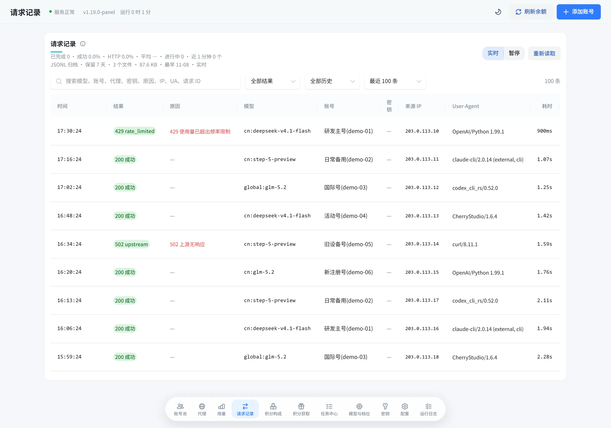

<div align="center">


# WorkBuddy2API

**把多个 WorkBuddy 账号变成一个 OpenAI 兼容的 API**

多账号池 · Claude Code / Codex 直连 · 积分任务自动化 · 内置 Web 管理面板

[](https://github.com/xin-LianK/wbtoapi/releases)
[](LICENSE)
[](https://github.com/xin-LianK/wbtoapi/pkgs/container/wbtoapi)

[快速开始](#快速开始) · [接入客户端](#接入客户端) · [功能](#功能) · [配置](#配置) · [API](#api-端点) · [文档](#文档) · [许可](#许可)

</div>

<picture>
  <source media="(prefers-color-scheme: dark)" srcset="docs/images/hero-dark.webp">
  
</picture>

## 这是什么

WorkBuddy2API 是一个自托管的账号网关。官方只给桌面客户端和插件提供服务，不对外提供 OpenAI 形态的开放接口；这个网关把账号凭证收在服务端，替你刷新 token、挑选可用账号、处理限流和换号，对外只暴露一套标准接口。

- **对客户端是标准接口**：OpenAI SDK、各类聊天客户端、编程工具填上地址和密钥就能用，不需要改代码。
- **对账号是统一资源池**：多个账号共享流量，单号限流、余额不足、登录失效各自处置，出错自动换号重试。
- **对你是可控的运维面**：内置面板看状态、改配置、跑任务、查日志，不用登服务器改文件。

> [!IMPORTANT]
> 本项目是非官方工具，只用于管理**你自己**的账号，仅限本人授权账号与私有环境使用。使用非官方客户端可能触发上游风控，账号风险由使用者自行承担。禁止批量注册、转售额度、加壳或捆绑收费，详见[使用边界](#使用边界)。

## 功能

### 三种接口入口，共用一套账号池

| 入口 | 端点 | 用途 |
|---|---|---|
| OpenAI 兼容 | `POST /v1/chat/completions` | 通用 SDK、聊天客户端、编程工具 |
| Anthropic Messages | `POST /v1/messages` | Claude Code 直接接入 |
| Responses | `POST /v1/responses` | Codex 直接接入 |

三个入口共用同一套选号、换号、冷却与会话粘性，出问题在面板的请求记录里一起看。

- **流式与非流式**：出站统一走 SSE，非流式在网关侧聚合成单条响应，`reasoning_content`、`tool_calls` 都保留。
- **模型路由**：客户端发来上游没有的模型名（Claude Code 的默认档位就是典型）时，按面板里配的规则改写成上游模型，客户端不用管模型叫什么。
- **联网搜索**：`/v1/search/messages` 把上游搜索包成 Anthropic 兼容形态，Claude Code 自带的 WebSearch 开箱可用；Codex 把 `/mcp` 加成 MCP 服务器就多一个搜索工具。
- **模型目录**：`/v1/models` 带上游返回的真实元数据——上下文长度、最大输出、思考档位、积分倍率。

### 账号池

- **选号**：先按实测成本分层（免费优先），层内再叠加「快过期优先」与剩余积分、闲置时长加权，在 Top-5 候选里随机，避免所有请求挤同一个号。
- **冷却与熔断**：限流按指数退避冷却，余额不足冷却到次日签到，连续失败熔断，每种错误单独处置，不把号一棍子打死。
- **封号即停**：命中封禁特征时禁用当事号并终止本次请求，不再把同一份请求灌给剩下的号，避免一个请求把整池号逐个打成封禁。
- **会话粘性**：同一段对话尽量留在同一个号上（默认 30 分钟滚动续期），多轮上下文不跳号，也吃得到上游前缀缓存。
- **并发与节奏**：单号在途请求数、每分钟请求数都能限，满了换号或排队；另有出站最小间隔与随机抖动。
- **分组与优先级**：账号可以分组，客户端密钥可以只用某几个组；组内还能设优先级，主力号先用、忙了才用备用号。
- **国内版与国际版**：模型名加 `cn:` / `global:` 前缀指定域；也可以合池负载均衡，或国内版优先、国际版只做后备。

### 按号代理，分散出口 IP

- 账号绑在代理池上，按绑号最少的规则分配并固定；代理支持批量粘贴导入，先预览再导。
- 自动测连通、查出口 IP，标出出口重复、与服务器同 IP、动态 IP；代理可设到期时间并提前提醒。
- 代理失效只暂停绑在上面的号、不罚号，久了自动改绑到同池可用的代理，从不悄悄退回服务器 IP。

### 积分任务自动化

- **每日任务**：签到、活跃上报、token 保活、猫猫旅行、夜猫子补足、余额刷新，各自独立开关和时点。
- **成长任务**：官方 18 个成长任务里 17 个可在面板上一键完成，推进进度、等待计分落定后自动领奖，新账号约 +1950 积分。
- **连登与抽奖**：签到排程末尾自动兑换已解锁的连登档位，有抽奖次数就抽完。
- **官方补偿**：先查补偿状态再领取，带截止日的补偿在面板上列倒计时，不会静默过期。
- **积分账本**：签到、领奖、补偿、旅行拿到的积分逐笔记账，面板里按时间、账号、来源查。

### 管理面板

内嵌在二进制里，`http://<你的地址>:7863/panel/` 直接打开，支持明暗主题和手机端。

| 视图 | 内容 |
|---|---|
| 账号池 | 账号状态、冷却倒计时、积分构成、在途、单号运维（签到 / 刷余额 / 解冻 / 禁用 / 移除）、批量操作、模型锁池 |
| 代理 | 代理池分组、绑定关系、连通与出口 IP、到期提醒 |
| 用量 | 请求数、token、失败尝试、延迟、Token 时序图、按账号 / 模型 / 域明细、积分扣除折算 |
| 请求记录 | 每次调用的结果、模型、账号、来源 IP、User-Agent、耗时、token、积分 |
| 积分构成 | 按到期日聚合的批次分布、账号构成对比、逐包明细 |
| 积分获取 | 积分变化流水，按时间、账号、来源筛选 |
| 任务中心 | 全账号扫描待办、排队执行、进度实时更新 |
| 模型与档位 | 上游实时模型目录，按能力、价格、上下文、输出上限筛选排序 |
| 密钥 | 客户端密钥的创建、限额、模型白名单、分组绑定、接入方法 |
| 配置 | 在线改 `config.json`，多数字段保存即生效 |
| 运行日志 | 任务 / 对话 / 系统三频道，自动滚动 |

<table>
  <tr>
    <td width="50%" align="center"><b>用量分析</b><br></td>
    <td width="50%" align="center"><b>请求记录</b><br></td>
  </tr>
  <tr>
    <td width="50%" align="center"><b>手机端账号池</b><br></td>
    <td width="50%" align="center"><b>手机端用量</b><br></td>
  </tr>
</table>

<sub>截图里的账号、积分和请求都是演示数据。</sub>

## 快速开始

**1. 启动**（Docker，Linux x64）

```bash
mkdir -p workbuddy2api/auths workbuddy2api/data && cd workbuddy2api

docker run -d --name workbuddy2api --restart unless-stopped \
  --user "$(id -u):$(id -g)" -p 7863:7863 -e TZ=Asia/Shanghai \
  -v "$PWD/auths:/app/auths" -v "$PWD/data:/app/data" \
  ghcr.io/xin-liank/wbtoapi:latest
```

首次启动会自动生成 `data/config.json`，其中 `api_key` 是随机值：

```bash
grep api_key data/config.json
```

**2. 添加账号**：浏览器打开 `http://localhost:7863/panel/`，输入密钥，点右上角「添加账号」，在浏览器里完成授权。国内版、国际版账号都行，加完立即进池，不用重启。

**3. 接入客户端**：Base URL 填 `http://localhost:7863/v1`，API Key 填上面那个密钥。

```bash
curl http://localhost:7863/v1/chat/completions \
  -H "Authorization: Bearer $API_KEY" \
  -H "Content-Type: application/json" \
  -d '{"model": "deepseek-v4-flash", "messages": [{"role": "user", "content": "你好"}], "stream": true}'
```

可用模型以 `/v1/models` 或面板「模型与档位」为准。

> [!TIP]
> 不想用 Docker？到 [Releases](https://github.com/xin-LianK/wbtoapi/releases) 下载对应平台的包（Windows / Linux / macOS），解压直接运行 `wb2api`，首次启动同样会自己生成配置。Compose、源码构建、反向代理、升级与备份见[部署与运维](docs/deployment.md)。

## 接入客户端

任何支持 OpenAI 兼容接口的客户端都可以：Cherry Studio、Chatbox、Open WebUI、各家 SDK 与编程工具，填 Base URL 和 API Key 就行。

```python
from openai import OpenAI

client = OpenAI(base_url="http://localhost:7863/v1", api_key="sk-...")
resp = client.chat.completions.create(
    model="deepseek-v4-flash",
    messages=[{"role": "user", "content": "你好"}],
)
print(resp.choices[0].message.content)
```

### Claude Code

```bash
export ANTHROPIC_BASE_URL=http://localhost:7863   # 注意不带 /v1
export ANTHROPIC_AUTH_TOKEN=sk-...                # 网关的 api_key
claude
```

想长期生效就写进 `~/.claude/settings.json` 的 `env`。模型有两种配法：

- **在面板配模型路由（推荐）**：「模型与档位 → 模型路由」点「添加 Claude Code 三档」，给 opus、sonnet、haiku 各挑一个上游模型。客户端什么都不用改，`/model` 切档位就是切规则。
- **在客户端指定**：`export ANTHROPIC_MODEL=glm-5.2`，或分别设 `ANTHROPIC_DEFAULT_OPUS_MODEL`、`ANTHROPIC_DEFAULT_SONNET_MODEL`、`ANTHROPIC_DEFAULT_HAIKU_MODEL`。

Claude Code 自带的 WebSearch 不用配：网关认出搜索请求，不交给模型，直接走上游的联网搜索接口。

上游模型的上下文比 Claude 小时，把 `CLAUDE_CODE_AUTO_COMPACT_WINDOW` 设成该模型的上下文长度（Claude Code 最低只认 100000），让它提前压缩对话。

### Codex

在 `~/.codex/config.toml` 里加一个提供方：

```toml
model_provider = "wb2api"
# model = "glm-5.2"   # 配了模型路由可以不写，用 Codex 默认模型名再由网关改写

[model_providers.wb2api]
name = "WorkBuddy2API"
base_url = "http://localhost:7863/v1"
env_key = "WB2API_KEY"
wire_api = "responses"
```

然后 `export WB2API_KEY=sk-...` 再运行 `codex`。`model_provider` 只能写在用户目录的配置里，项目内的 `.codex/config.toml` 会忽略它。

Codex 自带的网页搜索接不了上游（翻译时丢掉）。要联网搜索，把网关的 `/mcp` 加成 MCP 服务器：

```toml
[mcp_servers.wb2api]
url = "http://localhost:7863/mcp"
bearer_token_env_var = "WB2API_KEY"
```

`codex mcp list` 能看到它就是配好了。

### 给别人用

在面板「密钥」页建客户端密钥发给对方，不要把 `api_key` 发出去。客户端密钥只能调 `/v1/*` 和 `/mcp`、登不了面板，可以单独设到期时间、每天和总量的请求次数 / token / 积分上限、能用哪些模型、只用哪些账号分组的号，用量和请求记录按密钥分开统计。「接入方法」里有密钥原文和各家客户端的填法。

建过客户端密钥以后，`/v1/*` 和 `/mcp` 必须带有效密钥，规则见 [API 参考](docs/api.md#客户端密钥)。

## 配置

配置是一个 JSON 文件，面板「配置」页可以直接改，改完大多立即生效。下面是常改的几个字段，完整清单、默认值与热生效规则见[配置](docs/configuration.md)，`config.example.json` 是字段最全的参考。

| 字段 | 默认 | 说明 |
|---|---|---|
| `listen` | `:7863` | HTTP 监听地址 |
| `api_key` | 空 | 管理员密钥（网关与面板）；**为空则不鉴权**，公网部署必须设置 |
| `auth_dir` | `./auths` | 账号凭证目录 |
| `pool.max_in_flight` | `3` | 单个账号同时处理的请求数 |
| `pool.cross_realm` | `off` | 不带前缀的模型名怎么分域：`off` 只走国内版、`merge` 合池、`cn_first` 国内优先 |
| `pool.credit_floor` | `100` | 余额低于该值的号不再接收费模型，防止把余额打穿 |
| `pool.strategy.domestic` | `weighted_random` | 国内版选号策略：加权随机 / 轮询 / 顺序耗尽 |
| `pacing.per_minute` | `90` | 单号每分钟请求上限 |
| `prompt.mode` | `custom` | 系统提示词模式；客户端 system 常被误拦时用 `custom` |
| `schedule.*_enabled` | `true` | 签到、保活、旅行、活跃等定时任务开关 |

加载顺序是「JSON 文件 → `WB2A_*` 环境变量」，变量非空才覆盖，适合容器部署。

## API 端点

| 端点 | 鉴权 | 说明 |
|---|---|---|
| `POST /v1/chat/completions` | Bearer | OpenAI 兼容补全，流式 / 非流式，请求体上限 8 MiB |
| `POST /v1/messages` | Bearer | Anthropic Messages，供 Claude Code |
| `POST /v1/responses` | Bearer | Responses，供 Codex |
| `GET /v1/models` | Bearer | 模型列表，带上下文、输出上限、思考档位、积分倍率 |
| `POST /v1/search/messages` | Bearer | Anthropic 兼容形态的联网搜索 |
| `/mcp` | Bearer | MCP 服务器，给 Codex 提供搜索工具 |
| `GET /status` | Bearer | 账号池状态：每号积分、冷却、熔断、在途、粘性，以及按模型聚合的限流视图 |
| `GET /healthz` | 无 | 健康检查：有可用且未占满的账号返回 200，否则 503 |
| `/panel/api/*` | Bearer | 面板接口，可脚本化调用 |

鉴权规则很简单：`api_key` 非空才校验 `Authorization: Bearer <api_key>`，为空直接放行；`/healthz` 恒不鉴权。

请求与响应格式、流式行为、Claude Code 与 Codex 的翻译细节见 [API 参考](docs/api.md)。

## 部署

| 方式 | 适用 |
|---|---|
| `docker run` | 最快，见[快速开始](#快速开始) |
| Docker Compose | 服务器长期运行，`docker compose up -d`，配置挂载进容器 |
| 预编译二进制 | Windows / Linux / macOS，从 Releases 下载解压即用 |
| 源码构建 | 开发调试，`go build ./cmd/server` |

镜像在 `ghcr.io/xin-liank/wbtoapi`，标签用版本号（如 `1.19.0-panel`）或 `latest`。

升级：

```bash
docker pull ghcr.io/xin-liank/wbtoapi:latest
docker compose up -d --force-recreate
```

面板检测到新版本会提示，也可以直接在面板里一键更新；新版跑不稳会自动退回。

> [!NOTE]
> 服务本身只说 HTTP，公网部署请放在 Nginx / Caddy 之类的 HTTPS 反向代理后面，并配好访问限流。凭证以明文存在 `auths/`，`api_key` 泄露等于交出整个账号池。细节见[安全与合规](docs/security.md)。

## 开发

```bash
cd web && npm ci && npm run build   # 类型检查 + ESLint + 单测 + 构建到 internal/panel/dist
go build ./...
gofmt -l . && go vet ./... && golangci-lint run
go test ./...                       # 面板相关测试要读 internal/panel/dist，先跑一次前端构建
```

面板前端用 React 19 + TypeScript + Vite + HeroUI 构建，产物用 `go:embed` 打进二进制，所以改了前端必须重新构建才会反映到 Go 侧。测试不连外网，上游一律用 `httptest` 起假服务器。写代码与提交的约定见 [AGENTS.md](AGENTS.md) 和 [提交规则](docs/commits.md)。

## 常见问题

**提示权限不足或写入失败**：容器默认以非 root 运行，宿主机挂载目录属主不一致时写不进 `auths/`。用 `PUID=$(id -u) PGID=$(id -g) docker compose up -d` 启动，或把挂载目录改成对应属主。

**上游说频率超限 / 内容被拦**：先看[常见问题](docs/faq.md)里的错误码说明，再按[网关与选号](docs/gateway.md)调 `pacing.*` 与 `prompt.mode`。多数限流不是改请求头能解决的，先把出站节奏降下来。

**账号被封或不可用**：面板「账号池」里被硬禁用的号会标出来，确认是误判可以一键解封（清禁用、冷却和熔断）。真封禁无法通过网关恢复。

## 文档

| 文档 | 内容 |
|---|---|
| [部署与运维](docs/deployment.md) | Docker、Compose、二进制、源码构建、升级、备份、优雅停机 |
| [配置](docs/configuration.md) | 全部配置项与默认值、上游超时、环境变量、热生效规则 |
| [网关与选号](docs/gateway.md) | 选号策略、跨域负载均衡、会话粘性、错误处置、提示词与内容审核、工具调用还原 |
| [按号代理](docs/proxy.md) | 代理池分组、批量导入、分配规则、出口 IP、失效处理 |
| [定时任务](docs/tasks.md) | 签到、成长任务、任务中心、连登、旅行、补偿 |
| [Web 管理面板](docs/panel.md) | 各视图功能、时间范围、更新提醒、面板接口 |
| [API 参考](docs/api.md) | 端点、Claude Code 与 Codex 入口、模型路由、客户端密钥 |
| [官方客户端对照](docs/official-client.md) | 出站请求按官方桌面端对齐的依据与未对齐项 |
| [安全与合规](docs/security.md) | 凭证保管、网络暴露、日志敏感度、使用边界 |
| [常见问题](docs/faq.md) | 权限报错、限额、内容误拦、账号恢复 |
| [更新日志](docs/CHANGELOG.md) | 每个版本的新增、变更与修复 |
| [维护与排障](MAINTENANCE.md) | 上游失效的症状分流、错误码字典、跟随官方升级的复查步骤 |
| [发版与提交规则](docs/releasing.md) | 版本号规则、发版流程；提交格式见 [docs/commits.md](docs/commits.md) |
| [AGENTS.md](AGENTS.md) | 给 AI 编程工具看的仓库说明与开发约定 |

## 反馈

在 [Issues](https://github.com/xin-LianK/wbtoapi/issues/new/choose) 里选「问题反馈」「功能建议」或「使用求助」。反馈问题时请带上版本号、部署方式、账号类型，以及报错原文和运行日志（文字，不要只发截图）。贴之前先把 token、Cookie、手机号、邮箱、IP 打码。

## 使用边界

- 本项目只用于管理**你自己的**账号，请不要用它批量注册、收购账号或对外售卖额度。
- 上游服务条款禁止批量注册与商业转售接口，由此产生的一切后果由使用者承担。
- 任何加壳、加密、捆绑卡密收费的「版本」都是他人篡改的产物，与本项目无关，也无法审计，请勿购买——`auths/` 里存的是明文凭证。
- 这是一场不对称对抗：上游加一条规则的成本远低于适配的成本。仓库保持可用，但不承诺长期存活，也不对封号负责。

## 许可

本项目以 [AGPL-3.0-only](LICENSE) 发布，并依 AGPL-3.0 第 7 条附加署名条款；版权归属、附加条款全文与上游部分的 MIT 声明见 [NOTICE](NOTICE)。

按附加条款要求，在此声明：**本项目基于并包含 workbuddy2api-panel 的代码**（<https://github.com/yreidev/workbuddy2api-panel>）。分发本项目或修改版、或让别人通过网络使用时，须保留上述声明与出处，并以 AGPL-3.0 向这些用户提供完整源码。

修改版请在合理位置标明与原版不同，不要以原版或官方发布版的名义发布。
