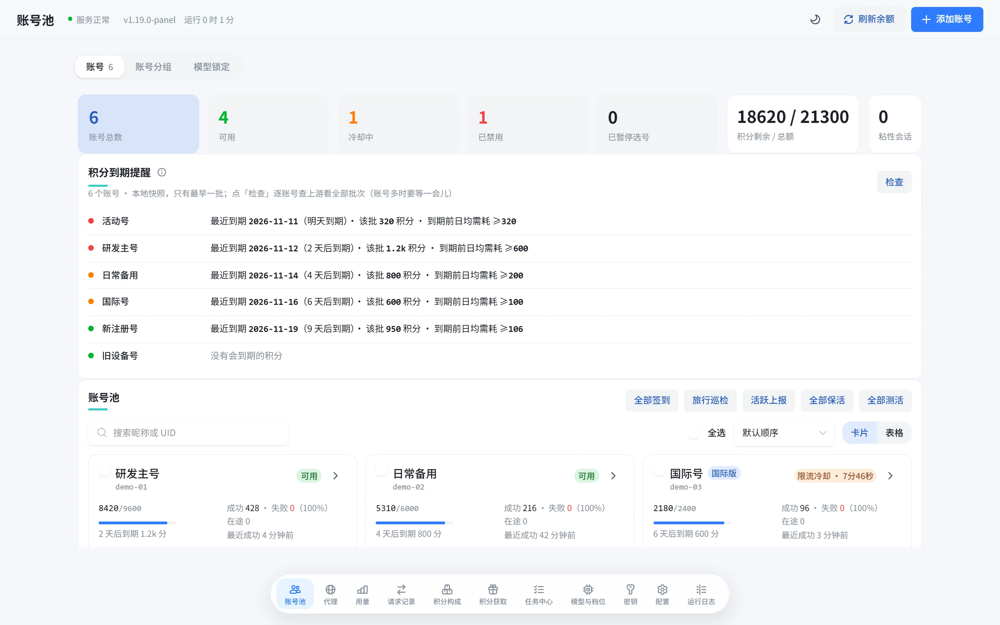
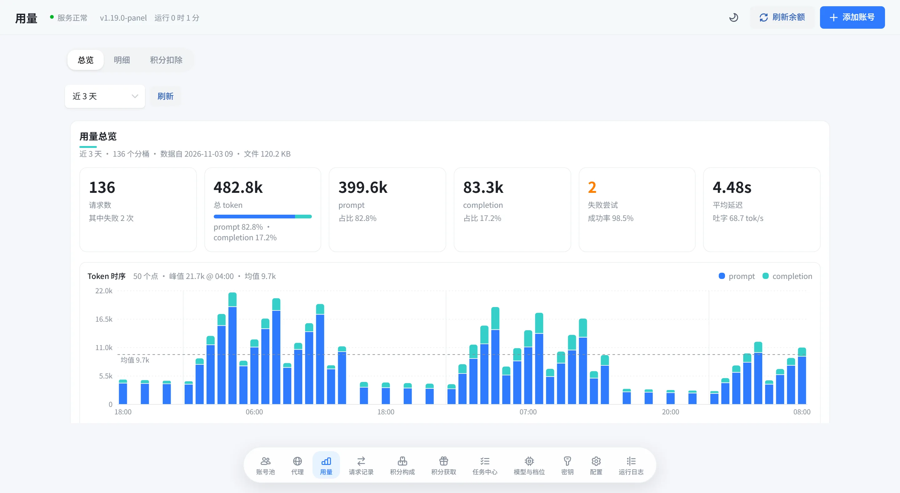
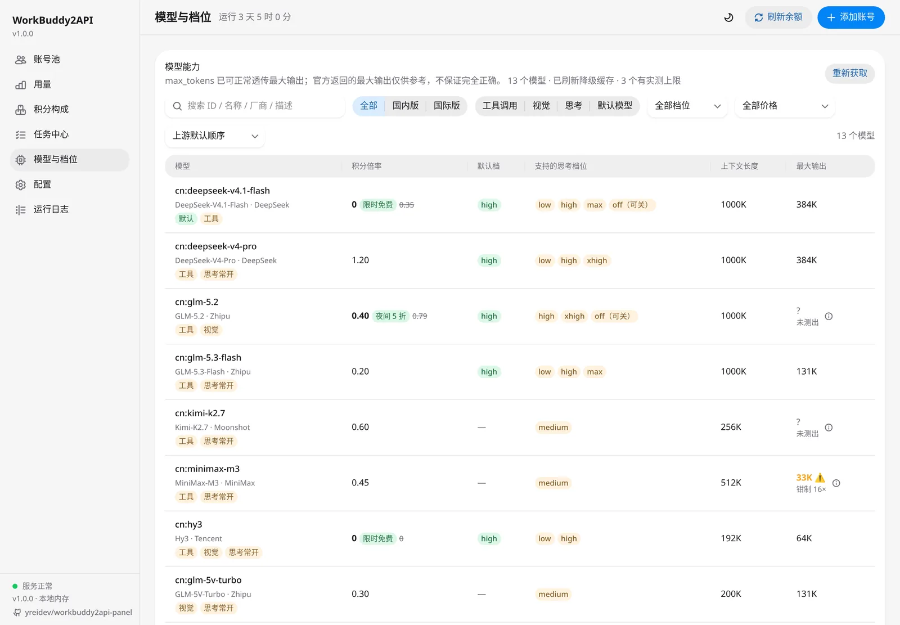
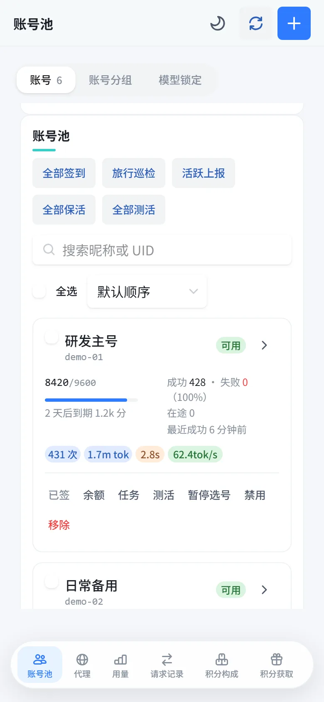
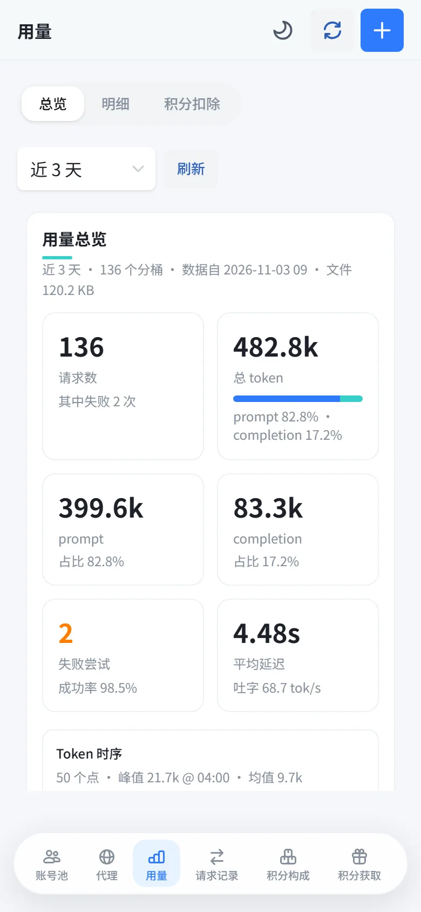
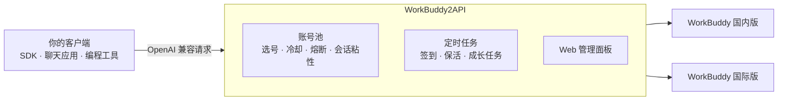
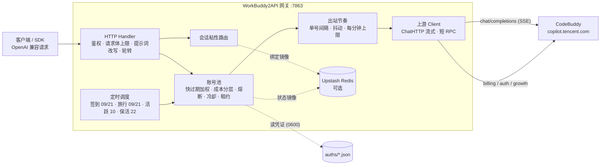

<div align="center">


# WorkBuddy2API Panel

**把腾讯 WorkBuddy 账号变成 OpenAI 兼容 API，Claude Code、Codex 直接接入，出站请求照官方客户端逐项对齐**

Claude Code / Codex 直连 · 模型路由 · 请求头对齐官方桌面端 5.9.3 · 主备入口与 HTTPDNS 自动切换 · 国内 / 国际双域合池 · 企业号用上 Claude · 积分任务全自动 · 面板一键更新

> [!IMPORTANT]
> **本仓库已接手维护（2026-10-21）**：新主页为 [`xin-LianK/wbtoapi`](https://github.com/xin-LianK/wbtoapi)，代码自即日起在此继续演进。
>
> 原仓库 [`linguo2625469/workbuddy2api-panel`](https://github.com/linguo2625469/workbuddy2api-panel) 已于同日发布停止维护声明，原因有三：
> 1. **上游已开始禁用反代**——WorkBuddy 对非官方客户端的识别与拦截正在收紧（通道校验、账号限制等），反代通道的稳定性与存活周期已不可控；
> 2. **个人精力有限**——原作者无力长期跟进协议变化与风控对抗；
> 3. **非法转卖泛滥**——大量批量注册小号、对外售卖额度、二次加壳 / 卡密分发，与项目初衷完全相悖。
>
> 本仓库保留原仓库的全部历史与代码，并继续做两件事：**逐项对齐官方客户端的出站形态**（当前对齐 WorkBuddy Desktop `5.8.3`），**以及补齐协议之外的存活能力**（出站节奏、并发约束）。但请清楚认知：**这是一场不对称对抗，上游加一条规则的成本远低于我们适配的成本**。仓库保持可用，但**上游随时可能再次收紧**；因使用非官方客户端导致的账号风控 / 封禁，由使用者自行承担。
>
> 维护与排障请先看 [MAINTENANCE.md](MAINTENANCE.md)：上游失效症状分流（协议漂移 / 通道校验）、错误码字典、跟随客户端升级的复查步骤、存活策略分层。
>
> **维护方式披露**：本仓库的代码审查、测试与修复实现**大量由 AI 辅助完成**（自动化编码 agent），合并与发布决策由维护者作出。请知悉后再使用或参与贡献。

> **代码血缘**：本仓库 `xin-LianK/wbtoapi` 不是单一 fork，而是三条代码线合并的产物，三者的版权与许可声明都保留在 [NOTICE](NOTICE)：
> 1. [`Sliverkiss/workbuddy2api`](https://github.com/Sliverkiss/workbuddy2api)（原始项目，已删库）—— 网关骨架、账号池调度、错误分类、提示词体系；
> 2. [`linguo2625469/workbuddy2api-panel`](https://github.com/linguo2625469/workbuddy2api-panel)（2026-10-21 停止维护）—— Web 管理面板、积分任务体系、请求指标；
> 3. [`yreidev/workbuddy2api-panel`](https://github.com/yreidev/workbuddy2api-panel) —— React + HeroUI 重写、出站指纹对齐；2026-11 合并其 tip（`f506537`，149 个提交）作为当前代码基线。
>
> 本仓库保留三条线的完整提交历史，并在合并后的基线上继续演进。上游设计的精巧之处（账号池调度、错误分类、提示词体系）原样保留，差异概览见 [与上游的差异](#-与上游的差异)。

[快速开始](#快速开始) · [和原版比](#和原版比多了什么) · [功能亮点](#功能亮点) · [接入客户端](#接入客户端) · [Claude Code](#claude-code) · [Codex](#codex) · [文档](#文档) · [致谢](#致谢) · [许可与署名](#许可与署名)

</div>

<picture>
  <source media="(prefers-color-scheme: dark)" srcset="docs/images/hero-dark.webp">
  
</picture>

> [!IMPORTANT]
> 本项目只用于管理**你自己的**账号。严禁批量注册小号、转售额度、加壳或捆绑卡密收费，详见文末[使用声明](#使用声明)。

WorkBuddy2API 是一个自托管网关：把你的多个 WorkBuddy 账号接成一个 OpenAI 兼容的 API，自动挑选可用账号、处理限流与换号，并每天替你完成签到和成长任务。现有的 SDK、聊天应用、编程工具填上地址和密钥就能用。

## 和原版比多了什么

GitHub 上叫 workbuddy2api-panel 的仓库有好几个。本仓库是三条代码线合并后的增强版（血缘见文首），**独立维护、独立发版**。下表的「原版」指最初的 [linguo2625469/workbuddy2api-panel](https://github.com/linguo2625469/workbuddy2api-panel)（2026-10-21 停止维护，本仓库在其后继续更新）；合并与同步记录见[项目来源与上游同步](docs/upstream.md)。和原版相比多了这些：

| | 本仓库 | 原版 |
|---|---|---|
| **Claude Code / Codex** | 原生提供 Anthropic Messages（`/v1/messages`）和 Responses（`/v1/responses`），填地址和密钥就能用；模型路由把它们的默认模型名改到上游模型，客户端不用配模型；Claude Code 自带的 WebSearch 直接能用，Codex 接网关的 MCP 服务器也能联网搜索 | 对话只有 `/v1/chat/completions`；联网搜索只有给 DSH 这类客户端调的 `/v1/search/messages` |
| **出站请求** | 照官方桌面端安装包（国内版 5.9.3、国际版 5.9.4）逐项对齐 UA、请求头、会话 id、链路头和 TLS 握手指纹，每一项的依据和还没对齐的地方都写在[官方客户端对照](docs/official-client.md) | UA 停在 WorkBuddy 5.5.4，还带着官方已经不发的 Origin、Referer 等旧请求头 |
| **网络容错** | 主入口出错切备用入口，DNS 失败或网关错误换 HTTPDNS 候选 IP，按入口熔断，规则照官方 | 单一入口，没有失败切换 |
| **对话隐私** | 默认告诉上游不许拿你的对话做模型优化（`X-Private-Data`），面板里可改 | 不发 |
| **企业号** | 用官方企业目录接口按账号拉模型，企业开通的 Claude 等模型只派给有它的号 | 所有企业号探测同一个旧端点 |
| **按号代理** | 每个号走自己的代理，分散出口 IP：代理分池、批量导入、按绑号最少分配并设上限；自动测连通、查出口 IP、到期提醒，代理坏了只暂停绑在上面的号、久了改绑；风控波按出口分开算 | 所有号从同一个出口 IP 出去 |
| **国内 + 国际** | 可以合成一个池负载均衡，或者国内版优先、国内版没号可用才用国际版（`pool.cross_realm`），也能用前缀钉死一域 | 用前缀分开用；另有默认关闭的跨域回退，国内选不到号才改用国际 |
| **会话缓存** | 客户端不带会话 id 时，从第一轮起给同一段对话定一个会话 id（UUID v7，官方形状），存盘、重启不变，两个域都发；换号时先回到这段对话用过的号 | 不带就拿网关自算的会话键充当，不是官方形状；连会话键也没有时每次随机补一个 |
| **成长中心** | 照官方桌面端用登录码换官网 Cookie 走网页接口，任务事件字段照 5.8.3 逐个核对 | 没有网页登录态 |
| **客户端密钥** | 给别人用另建密钥：到期时间、每天和总量上限、模型白名单、只用哪些分组的号，用量和请求记录按密钥分开 | 只有一把共用的 `api_key` |
| **管理面板** | React + HeroUI 重写，手机端、明暗主题、凭证导出与批量导出、多选批量操作 | 原生 JS 面板 |
| **升级** | 面板提醒新版本，一键更新，新版跑不稳自动退回 | 没有一键更新 |
| **工程质量** | 233 个测试文件，断网全量可跑，覆盖率 98.8%；CI 跑 gofmt、go vet、golangci-lint 和提交规则检查，提交全部签名 | 97 个测试文件 |

## 功能亮点

- 🛡️ **请求照官方客户端对齐**
  - 出站请求照官方桌面端安装包逐项对齐，对齐的依据和还没对齐的地方都写在[官方客户端对照](docs/official-client.md)，官方升级后照着核对。
  - 主入口出错时自动切备用入口，DNS 失败或网关错误换 HTTPDNS 候选 IP，切换规则照官方。
  - 默认不允许上游拿你的对话做模型优化。

- 🔌 **OpenAI、Claude Code、Codex 都能直接接**
  - 提供 `/v1/chat/completions` 与 `/v1/models`，流式、非流式、工具调用、图片输入、推理档位都支持。
  - Claude Code 走 `/v1/messages`，Codex 走 `/v1/responses`，和普通对话共用同一套选号、换号与日志。
  - 联网搜索走官方的搜索接口：Claude Code 自带的 WebSearch 不用配就能用，Codex 把网关的 `/mcp` 加成 MCP 服务器。
  - 模型路由：客户端发来上游没有的模型名（比如 Claude Code 的默认模型）时按规则改用上游模型，在面板里配。
- 🔄 **多账号池，坏了自动换**
  - 按实测成本、剩余积分、闲置时长加权选号。
  - 限流、余额不足、登录失效分别处置，出错自动换号重试。
  - 每个号都能一键测活；限流冷却、熔断中的号每 30 分钟自动测一次，测通就提前恢复。
  - 同一会话尽量不跳号。
  - 可限每个号同时几个请求、每分钟几个请求，满了换号或排队。
  - 号可以设优先级：主力号先用，都忙了才用备用号；上游说这个号不能用的模型自动屏蔽，也能手动给号排除模型。
- 🌐 **按号代理，分散出口 IP**
  - 号绑在代理池上，按绑号最少分到一个代理并固定下来；代理批量粘贴导入，先预览再导。
  - 自动测连通、查出口 IP，标出出口重复、和服务器同 IP、动态 IP；代理可设到期时间，提前提醒。
  - 代理坏了或到期，只暂停绑在上面的号、不罚号，久了自动改绑到同池能用的代理；从不退回服务器 IP。
- 🌏 **国内版 + 国际版同池管理**
  - 模型名加 `cn:` / `global:` 前缀指定走哪一版。
  - 也可打开跨域负载均衡，让两边的账号一起分担，或者国内版优先、国际版只做后备。
  - 企业号按自己的模型目录接请求，企业开通的模型（比如 Claude）也能用。
- 🎯 **积分任务全自动**
  - 每天自动签到、活跃上报、token 保活、连登兑换与抽奖。
  - 官方 18 个成长任务里 **17 个一键完成**，新账号约 **+1950 积分**。
  - 签到、领奖、补偿、旅行领到的积分逐笔记账，面板「积分获取」页按时间、账号、来源查。
- 🖥️ **好用的管理面板**
  - 账号状态与冷却倒计时、模型限额、用量与积分分析、任务中心、请求日志。
  - 给别人用另建客户端密钥，能限到期、用量和模型，还能只给它用某几个分组的号，用量按密钥统计。
  - 在线改配置，大多立即生效；支持明暗主题和手机端。
- 📦 **部署省心**
  - 一条 `docker run`，或下载一个可执行文件直接运行。
  - 首次启动自动生成配置和随机密钥，在面板里用浏览器登录添加账号。
  - 有新版本时面板提醒，一键更新，新版跑不稳自动退回。

<table>
  <tr>
    <td width="50%" align="center"><b>用量分析</b><br></td>
    <td width="50%" align="center"><b>模型与档位</b><br></td>
  </tr>
  <tr>
    <td width="50%" align="center"><b>任务中心</b><br></td>
    <td width="50%" align="center"><b>手机端</b><br> </td>
  </tr>
</table>

<sub>截图均为演示数据。</sub>

## 快速开始

**1. 启动**（Docker，Linux x64）

```bash
mkdir -p workbuddy2api/auths workbuddy2api/data && cd workbuddy2api

docker run -d --name workbuddy2api --restart unless-stopped \
  --user "$(id -u):$(id -g)" -p 7863:7863 -e TZ=Asia/Shanghai \
  -v "$PWD/auths:/app/auths" -v "$PWD/data:/app/data" \
  ghcr.io/xin-liank/wbtoapi:latest
```

首次启动会生成 `data/config.json`，`api_key` 是随机值，用 `grep api_key data/config.json` 查看。

**2. 添加账号**：浏览器打开 `http://localhost:7863/panel/`，输入密钥，点右上角「添加账号」，登录你的 WorkBuddy 账号（国内版、国际版都行）。账号立即进池，不用重启。

**3. 接入客户端**：Base URL 填 `http://localhost:7863/v1`，API Key 填上面的密钥，见下一节。

> [!TIP]
> 不用 Docker？到[最新构建](https://github.com/xin-LianK/wbtoapi/releases/tag/latest)下载对应平台的包（Windows / Linux / macOS），解压后直接运行 `wb2api`。Docker Compose、源码构建、升级与备份见[部署与运维](docs/deployment.md)。

## 接入客户端

任何支持 OpenAI 兼容接口的客户端都可以：Cherry Studio、Chatbox、Open WebUI、各类 SDK 与编程工具，填 Base URL 和 API Key 即可。Claude Code、Codex 的接法见下面两小节。

```bash
curl http://localhost:7863/v1/chat/completions \
  -H "Authorization: Bearer $API_KEY" \
  -H "Content-Type: application/json" \
  -d '{"model": "deepseek-v4-flash", "messages": [{"role": "user", "content": "你好"}], "stream": true}'
```

```python
from openai import OpenAI

client = OpenAI(base_url="http://localhost:7863/v1", api_key="sk-...")
resp = client.chat.completions.create(
    model="deepseek-v4-flash",
    messages=[{"role": "user", "content": "你好"}],
)
print(resp.choices[0].message.content)
```

可用模型以 `/v1/models` 或面板「模型与档位」为准。模型名不带前缀时默认走国内版，`global:gpt-5.5` 这样加前缀走国际版。

### Claude Code

```bash
export ANTHROPIC_BASE_URL=http://localhost:7863   # 不带 /v1
export ANTHROPIC_AUTH_TOKEN=sk-...                # 网关的 api_key
claude
```

也可以写进 `~/.claude/settings.json` 的 `env` 里长期生效。模型有两种配法，任选其一：

- **在面板配模型路由（推荐）**：「模型与档位 → 模型路由」点「添加 Claude Code 三档」，给 opus、sonnet、haiku 各选一个上游模型。客户端什么都不用改，`/model` 切档位就是切规则；
- **在客户端指定**：`export ANTHROPIC_MODEL=glm-5.2`，或分别设 `ANTHROPIC_DEFAULT_OPUS_MODEL`、`ANTHROPIC_DEFAULT_SONNET_MODEL`、`ANTHROPIC_DEFAULT_HAIKU_MODEL`。

Claude Code 自带的 WebSearch 工具不用配：网关认出它发来的搜索请求，不交给模型，直接用官方的联网搜索接口搜，见 [API 参考](docs/api.md#联网搜索)。

上游模型的上下文比 Claude 小时，把 `CLAUDE_CODE_AUTO_COMPACT_WINDOW` 设成该模型的上下文长度（Claude Code 最低只认 100000），让它提前压缩对话。Anthropic 不为「Claude Code 接非 Claude 模型」提供支持，遇到问题请在本仓库反馈。

### Codex

在 `~/.codex/config.toml` 里加一个提供方：

```toml
model_provider = "wb2api"
# model = "glm-5.2"   # 配了模型路由可以不写，用 Codex 默认的模型名再由网关改写

[model_providers.wb2api]
name = "WorkBuddy2API"
base_url = "http://localhost:7863/v1"
env_key = "WB2API_KEY"   # 从这个环境变量读网关的 api_key
wire_api = "responses"
```

然后 `export WB2API_KEY=sk-...` 再运行 `codex`。`model_provider` 只能写在用户目录的配置里，项目里的 `.codex/config.toml` 会忽略它。

Codex 自带的网页搜索接不了上游（翻译时丢掉）。要联网搜索，在同一个文件里把网关的 `/mcp` 加成 MCP 服务器，模型就多一个 `mcp__wb2api__web_search` 工具：

```toml
[mcp_servers.wb2api]
url = "http://localhost:7863/mcp"
bearer_token_env_var = "WB2API_KEY"   # 和上面的 env_key 用同一个变量
```

`codex mcp list` 能看到它就是配好了。

两个入口的翻译细节、模型路由的匹配规则见 [API 参考](docs/api.md#claude-code-与-codex-入口)。

### 给别人用

在面板「密钥」页建客户端密钥发给对方，不要把 `api_key` 发出去。客户端密钥只能调 `/v1/*` 和 `/mcp`、登不了面板，可以单独设到期时间、每天和总量的请求次数 / token / 积分上限、能用哪些模型、只用哪些账号分组的号，用量和请求记录按密钥分开统计；「接入方法」里有密钥原文和各客户端的填法。建过客户端密钥以后 `/v1/*` 和 `/mcp` 必须带有效密钥，规则见 [API 参考](docs/api.md#客户端密钥)。

## 常用配置

配置文件是 JSON，面板「配置」页可以直接改。

| 字段 | 默认 | 说明 |
|---|---|---|
| `api_key` | 随机生成 | 管理员密钥（网关与面板），**为空则不鉴权**；给别人用另建[客户端密钥](#给别人用) |
| `pool.max_in_flight` | `3` | 单个账号同时处理的请求数 |
| `pool.cross_realm` | `off` | 不带前缀的模型名怎么在两个域之间分：`off` 只走国内版，`merge` 合池负载均衡，`cn_first` 国内版优先、没号可用才用国际版 |
| `pool.credit_floor` | `0` | 余额低于该值的账号不再接收费模型，防止把余额打穿 |
| `prompt.mode` | `passthrough` | 客户端系统提示词常被上游审核误拦时，改成 `custom` |
| `schedule.*_enabled` | `true` | 签到、保活、成长任务等定时任务的开关 |

完整字段、默认值和环境变量见[配置](docs/configuration.md)。

## 工作原理



## 文档

| 文档 | 内容 |
|---|---|
| [部署与运维](docs/deployment.md) | Docker、Compose、二进制、源码构建；添加账号、升级、备份、优雅停机、工具脚本 |
| [配置](docs/configuration.md) | 全部配置项与默认值、上游超时、环境变量、热生效规则 |
| [网关与选号](docs/gateway.md) | 选号策略、跨域负载均衡、会话粘性、错误处置、提示词与内容审核、工具调用还原 |
| [按号代理与代理池](docs/proxy.md) | 代理池分组、批量导入、分配与上限、代理不通与到期、出口 IP、只许走号的代理、风控波按出口分开算 |
| [定时任务与积分任务](docs/tasks.md) | 签到、成长任务一键完成、任务中心、连登、旅行、暂停选号、企业版账号 |
| [Web 管理面板](docs/panel.md) | 各视图功能、时间范围、调用来源、更新提醒与一键更新、面板接口、安全响应头 |
| [API 参考](docs/api.md) | 对外端点、Claude Code 与 Codex 入口、模型名与模型路由、健康检查、请求日志、上游接口 |
| [官方客户端对照](docs/official-client.md) | 出站请求按官方桌面端对齐的依据、未对齐项、官方升级后怎么核对 |
| [安全与合规](docs/security.md) | 凭证保管、网络暴露、日志敏感度、使用边界 |
| [常见问题](docs/faq.md) | 权限报错、6004 限额、内容审核误拦、账号恢复等 |
| [项目来源与上游同步](docs/upstream.md) | 项目沿革、相对原始项目新增的能力、同步记录 |
| [更新日志](docs/CHANGELOG.md) | 每个版本的新增、变更与修复 |
| [发版与版本号](docs/releasing.md) | 版本号规则、发版流程、更新日志的格式 |
| [提交规则](docs/commits.md) | 提交信息格式、type 与 scope、CI 检查与本地钩子 |
| [issue 处理](docs/issues.md) | 写给维护者：表单、标签、信息检查与超期关闭，平时怎么打标签、关闭选什么理由 |
| [AGENTS.md](AGENTS.md) | 给 AI 编程工具看的开发说明，以及复制、借鉴本项目代码时的署名要求 |

## 反馈问题

在 [issue](https://github.com/linguo2625469/workbuddy2api-panel/issues/new/choose) 里选「问题反馈」「功能建议」或「使用求助」填表。问题反馈要填版本号、部署方式、出问题的账号类型，并贴报错原文和运行日志（文字，不要只发截图；面板整页出错时点出错页上的「复制错误信息」）；缺了机器人会留言提醒、打上「待补充」，14 天没补充自动关闭，之后补上信息回复一下会自动重新打开。贴出来之前先把 token、Cookie、手机号、邮箱、IP 打码。

## 致谢

本项目站在这些项目和贡献者的肩膀上：

- **[linguo2625469/workbuddy2api-panel](https://github.com/linguo2625469/workbuddy2api-panel)**：本仓库的直接上游，已于 2026-10-21 停止维护。Web 管理面板、积分任务体系、请求指标等大量能力都来自这里。
- **[Sliverkiss](https://github.com/Sliverkiss)**：原始项目 workbuddy2api 的作者，奠定了网关、账号池调度、错误分类与提示词体系（原仓库已删除）。
- **同类项目**：
  - [corrinehu](https://github.com/corrinehu) 的 dsh-workbuddy-connect：企业号拉模型目录必须带齐企业身份的实测（issue #123），企业版模型的支持据此实现（原仓库已删除）。
  - [caigee-cmd/cli2api](https://github.com/caigee-cmd/cli2api)：每个账号各拉一份模型目录、按目录选号的做法，企业号的对话请求头，以及号没设代理时回落全局代理的做法。
  - [ardeyouxipianyi/workbuddy2api-hub](https://github.com/ardeyouxipianyi/workbuddy2api-hub)：自我介绍句、DeepSeek Harness、OhMyOpenCode 这几类渠道指纹的清洗规则，国际版号成批被 11140 风控时整域暂停的做法（issue #629），以及每段对话记下用过的号、换号时先回到这些号的做法。
  - [ithtelab/workbuddy-manager](https://github.com/ithtelab/workbuddy-manager)、[mmqz/cpa-multi-plugins](https://github.com/mmqz/cpa-multi-plugins)：渠道指纹在助手历史和用户消息里同样会被拦的实测；cpa-multi-plugins 凭证文件里带 `proxy_url` 的写法，导入凭证时据此认出号的代理。
  - [sofs2005/w2a](https://github.com/sofs2005/w2a)：用原始字节确认上游回的是数字码 `11128`。
  - [misakano7545/workbuddy2api-panel](https://github.com/misakano7545/workbuddy2api-panel)：AutoBot.yml 整理好的同类项目清单；对齐登录的提交提醒了授权被拒的登录业务码和毫秒的到期时间，网关对照官方安装包核实后补上；它的真机抓包里积分、签到用的是 `axios/1.16.1`，国际版后台请求的 UA 两段都是 `workbuddy-ai`，网关据此回安装包查实，改掉了这两处旧缺口。
  - [magpie-community/plugins](https://github.com/magpie-community/plugins) 的 WorkBuddy 插件：对齐桌面端 5.9.3 时对照了它的请求头，它的说明提醒了官方对话经 OpenAI SDK 发出、带 `X-Stainless-*` 头，网关对照官方安装包核实后记进了[官方客户端对照](docs/official-client.md#与桌面端-593-的对照)。
- **其他 API 网关**：
  - [QuantumNous/new-api](https://github.com/QuantumNous/new-api)：调用日志单独成页、失败请求直接显示原因的做法，以及渠道测试（单测、测试全部、定时只测被自动禁用的渠道、测通自动启用）的做法，网关的账号测活照此实现。
  - [router-for-me/Cli-Proxy-API-Management-Center](https://github.com/router-for-me/Cli-Proxy-API-Management-Center)：账号卡片网格的排法，以及日志页把服务日志和出错请求分开的做法。
  - [Wei-Shaw/sub2api](https://github.com/Wei-Shaw/sub2api)：号都在途占满时请求排队等空位、最多等 30 秒的做法（`fallback_wait_timeout`），每号每分钟请求数上限（账号的 `base_rpm`），以及各类日志各设保留天数、改了立即生效的做法（`ops.cleanup` 的 `*_retention_days`），账号「测试连接」弹窗和定时测试测通后自动恢复账号（`auto_recover`）的做法，以及代理管理的做法（代理表、账号绑定代理、代理到期、经代理查出口 IP、错误按代理归因），代理池照此实现；账号分组、API 密钥绑分组和账号优先级（`priority`，数字小的先用、只在最高一层里挑）也照它的做法。
- **上游的每一位贡献者**：

  <a href="https://github.com/linguo2625469/workbuddy2api-panel/graphs/contributors"></a>

- **开源依赖**：
  - 前端：[HeroUI](https://github.com/heroui-inc/heroui)、[React](https://github.com/facebook/react)、[TanStack Query 与 Router](https://github.com/TanStack)、[Recharts](https://github.com/recharts/recharts)、[Tailwind CSS](https://github.com/tailwindlabs/tailwindcss)、[Gravity UI Icons](https://github.com/gravity-ui/icons)、[Vite](https://github.com/vitejs/vite)。
  - 后端：[CLIProxyAPI](https://github.com/router-for-me/CLIProxyAPI)（Claude Code、Codex 入口的协议翻译层）、[go-redis](https://github.com/redis/go-redis)、[andybalholm/brotli](https://github.com/andybalholm/brotli)、[klauspost/compress](https://github.com/klauspost/compress)。
- **图标**：来自 [DGZSbot/ai-icon](https://github.com/DGZSbot/ai-icon)。

## 使用声明

本项目（含原始项目 Sliverkiss/workbuddy2api 与上游 linguo2625469/workbuddy2api-panel，下同）的开发初衷只有一个：**方便个人管理自己的 WorkBuddy 账号**，包括自动签到、保活，给自己的本地工具提供一个 OpenAI 兼容入口。它是免费、开源、按「原样」提供的个人自用工具。

近期我们发现有人将本项目用于以下行为：

- **批量注册小号 / 收购账号，对外提供付费 API、共享池、代充等业务**；
- **二次加壳、捆绑卡密（授权码）售卖**，或以「公益服」「低价中转」等名义变相收费分发。

我们对上述行为**表达最强烈的反对**，并声明如下：

1. **一切商用 / 售卖行为与本项目及作者无关。** 本项目不授权、不支持、不参与任何面向公众的 API 售卖、账号池出租、卡密收费分发；行为人由此产生的一切后果（包括但不限于账号封禁、条款违约与法律风险）由其自行承担，与作者和贡献者无任何关系。
2. **批量注册与转售接口配额违反目标平台服务条款。** 腾讯系服务条款禁止批量注册账号及商业转售接口。原始项目仓库已删除、停止公开维护，我们无法断定具体原因；上游 linguo2625469/workbuddy2api-panel 也已于 2026-10-21 停止维护，公开列出的原因之一就是非法转卖泛滥。此类滥用行为正在毁掉所有正常使用者的环境，请勿再消耗社区的善意。
3. **请勿购买任何「收费版」「卡密版」「公益中转版」。** 本项目永远免费开源。任何加壳、加密、捆绑收费的「版本」都是他人篡改的产物，与本项目无关；且此类分发无法审计，存在被植入后门、回传并窃取你账号凭证的风险（`auths/` 中保存的是明文 access token / refresh token）。**你付钱买到的不是本项目，而是把自己账号交给陌生人的机会。**
4. **关于开源协议的诚实说明。** 本项目自 v1.4.0 起改用 AGPL-3.0 并附署名条款（见[许可与署名](#许可与署名)），v1.3.0 及更早的版本仍是 MIT。使用、修改、分发的自由不变，这是开源的本意，我们不会收回；但分发或对外提供服务的人必须公开源码、保留署名，加壳闭源售卖不在许可之内。许可赋予的是代码层面的自由，**不赋予**以本项目名义宣传、售卖、捆绑分发，或要求作者提供支持与背书的权利。作者不为任何第三方分发版本提供支持、更新承诺或安全保证。
5. **作者保留止损的权利。** 若滥用行为持续，作者可能随时停止维护、关闭或删除仓库，且不另行通知。

如果你的用途是管理自己的账号，欢迎正常使用、反馈问题与提交 PR。

## 项目简介

WorkBuddy2API 是一个自托管的 **OpenAI 兼容反向代理网关**，将腾讯 CodeBuddy（`copilot.tencent.com`）账号包装为统一的 `/v1/chat/completions` 服务。

- 官方不提供 OpenAI 形态的开放 API，本项目通过 **OAuth 设备授权**（面板「添加账号」或 `login.sh`）获取账号凭证，在网关侧做 token 自动刷新、账号池调度与流量治理；
- 面向 **个人多账号** 场景：多账号共享、单号故障自动换号、冷却 / 熔断防止雪崩、会话粘性保证多轮上下文不跳号；
- 对客户端只暴露 OpenAI 兼容接口，现有 SDK / 前端 / 工具 **零改造接入**。

> ⚠️ 合规须知：本项目是**非官方**网关，使用 CodeBuddy 账号作为上游，**仅限本人授权账号、本机 / 私有环境测试**。详细边界见[安全与合规](#安全与合规)。

## 核心能力

| 能力 | 说明 |
|---|---|
| 🔑 **OAuth 一键登录** | `login.sh` 设备授权流程，自动落盘凭证并重启容器加载新账号 |
| 🔄 **多账号池** | 快过期积分加权 + 成本分层 + 加权随机选号，Top-5 候选 + 防惊群 |
| 🛡️ **熔断与冷却** | 429 软冷却 600s 起指数退避（封顶 `soft_rate_max`）、404 固定 60s 短冷却、402 硬冷却至次日 04:00、连续失败熔断、在途租约限流 |
| 🧲 **会话粘性** | 同一会话（`conversation_id`）尽量绑定同一账号，TTL 滚动续期，失败自动解绑，可镜像 Redis 防重启丢失 |
| ⏱️ **出站节奏** | 同账号最小间隔 + 随机抖动 + 每分钟上限（默认 120ms/180ms/90 次）。在途租约只管「同时几个」，这层管「每秒几个」——高频出站比请求头更容易被风控选中，详见 [MAINTENANCE.md §6](MAINTENANCE.md) |
| 📊 **请求指标简报**（手动，不在每日任务里） | `./deploy.sh stats` 读 `data/request-logs` 的脱敏 JSONL，给出昨日失败率、status 分布、重试比例与**前日环比**；失败率 +2pp 或 403/429 翻倍（≥3 次）即退出码 1。上游收紧口径时这是比客户端发版更早的信号 |
| 🔍 **上游形态快照** | 客户端升级后自动发现协议漂移：解包提取（主）+ 抓包导入（辅）写进同一份 shape，跨版本 diff 头名/值形态/条件/端点；`./deploy.sh shape --selftest` 自检 9 类漂移，`./deploy.sh watch` 每日跑（版本没变毫秒级跳过） |
| 🎭 **官方出站形态** | 出站头按 WorkBuddy 桌面端 `5.8.3` 实测形态组装（非企业 27 头 / 带 domain 28 头 / 企业号 29 头），UA、trace、UUID v4 全部对齐；`legacy` profile 可一键回滚；`./deploy.sh headers` 离线打印实际出站头（见[出站请求头形态](#出站请求头形态upstreamprofile)） |
| ⏰ **定时任务** | 签到（09/21 点，末尾自动跑**连登管家**：兑换已解锁档位 + 抽完抽奖次数）+ 活跃上报（10 点，点亮连登 / 解锁领养 + streak 自检）+ 猫猫旅行（09/21 点，独立排程）+ token 保活（22 点），四类独立开关 |
| ⚡ **流式 + 非流式** | 出站强制 `stream:true`；SSE 帧按规范白名单重建；非流式由本地聚合为单响应 |
| 🧠 **推理模型兼容** | DeepSeek 思维链注入（`thinking.type=enabled` + 默认档）、`reasoning_content` 多轮回填、effort 档位自动降级 |
| 🔍 **联网搜索** | `POST /v1/search/messages` 把上游 `/agenttool/v1/search` 包成 Anthropic Messages 兼容形态（DSH 等客户端的搜索 provider 零改动接入）；复用账号池选号 / 在途租约 / token 刷新 / 错误冷却，出站请求头对齐官方客户端 |
| 💬 **系统提示词体系** | 网关自有提示词替换客户端 system（默认 `custom`），从源头消灭 system 来源的内容误报；`passthrough` 遇拦截自动降级重试 |
| 🗑️ **指纹脱敏** | 出站请求体黑名单指纹字段清洗（可关闭），与提示词体系两层叠加 |
| 📊 **可观测** | 每请求一行表格日志（TTFB / token 速率 / uid）；`/healthz` 带 `service` 身份标识可接负载均衡 / 宿主探活 |
| 💾 **状态持久化** | 池状态本地原子落盘 + Upstash Redis 异步镜像（可选），重启择新恢复 |
| 🖥️ **Web 管理面板** | 内嵌单页面板（明暗主题，七个视图）：账号运维 / 用量与积分分析 / 模型档位条件查询 / 在线改配置（热生效）/ 运行日志（含**调用来源 IP·UA** 与时间区间）/ 积分任务，见 [Web 管理面板](#-web-管理面板) |

## 🎯 成长任务一键完成（17/18）

官方「成长计划」的 18 个成长任务中，**17 个可在面板上一键纯 API 完成**——无需安装官方客户端、无需人工交互，点一下「一键完成」即自动推进进度、等待异步计分落定并**自动领奖**。剩余任务展示操作指引。

### 任务覆盖与奖励

| 任务 | 奖励 | 一键完成方式 |
|---|---|---|
| `first_buddy` | +300c +8e | 解锁上报 → 同意协议 → 领养第一只 Buddy |
| `create_canvas` | +300c +5e | 设计画布创建事件组（Ardot 遥测） |
| `chat_5` | +100c | 对话活跃上报 ×5（自动补足差额） |
| `Model_chat_GLM5.2` | +100c +5e | glm-5.2 真实对话一次（发一条短消息） |
| `RichMeow_Chat` | +100c +5e +UR Buddy | 桌面端对话事件链（6 事件，含成功回执） |
| `Buddy_App` | +100c +5e | Buddy 应用「发现→进入→授权」事件链 |
| `Buddy_App_QQ` | +50c +5e | 企鹅教师助手进入事件链（与上一条共用） |
| `automation_1` | +100c +5e | 定时任务创建成功事件 |
| `Library_read` | +100c +5e | 资料库阅读点击（web 域上报） |
| `template_5` | +100c +5e | 模板使用事件组 ×5 |
| `playbook_prompt` | +100c +5e | 灵感案例「做同款」发送事件 |
| `expert_5` | +100c +5e | 真实专家召唤+使用链 ×5（专家市场拉真实专家 → 真实对话 → 使用事件） |
| `Expert_team_use_3` | +100c +5e | 专家团召唤+使用链 ×3 |
| `Hp_Appearance` | +100c +5e | 主题设置 + 皮肤生效事件 |
| `Expert_lighthouse` | +100c +5e | 轻量云专家召唤+使用链（真实对话 requestId，**可免费领一个月轻量服务器**） |
| `skill_1` | +100c +5e | 真实对话 + 技能加载事件（skill_info） |

**全新账号一键全做完 ≈ +1950 credits +78 能量**，其中仅数个任务涉及真实对话（`Model_chat_GLM5.2` 一条、`expert_5`/`Expert_team_use_3`/`skill_1` 各数条 fast-model 短对话），其余全部为行为事件上报，零对话消耗。

### 不可自动的 1 个

| 任务 | 原因 |
|---|---|
| `Expert_Philanthropy` | 需真实捐款（服务端领奖时校验捐赠回执，已实测无法绕过） |

### 实现原理（简述）

任务计分走 `/v2/report` 行为上报，但**不同任务认不同客户端指纹**：CLI 指纹（`www.codebuddy.cn`）、桌面指纹（`copilot.tencent.com` + `WorkBuddy/5.5.6` UA + `workbuddy-desktop` 事件族）、web 指纹（`www.workbuddy.cn` + `x-client-platform: web`）。网关为每类任务构造对应指纹的判据事件链（`internal/upstream/desktop.go`）；专家类任务额外要求真实专家 id 与真实对话回执（`internal/upstream/streak.go` 之外的 expert 序列）。上报 200 ≠ 计分——面板在执行后轮询任务进度，达标即自动调用 Web 域领奖接口。

> ⚠️ 行为事件按天幂等：重复点「一键完成」不会重复扣资源，已达标的任务自动跳过。

### 🧭 任务中心（面板新视图）

「任务中心」视图把散落的任务能力收拢成一处：

- **全账号任务扫描**：一键拉取每个账号的成长任务（未完成且可自动化的 19 项，含小程序口径的「校园日」与「小程序首对话」）+ 开学季待办，列表一目了然
- **执行队列**：把待办按账号排队执行——账号内串行（与单任务/一键完成共用互斥锁），账号间可选并发（1-3）；执行进度实时更新到每个条目
- **开学季独立状态卡**：每账号 5 任务（分享/桌面/对话×3/专家/学生认证）的状态矩阵 + 剩余抽奖次数，一键触发全账号闭环
- **日志分频道**：运行日志按「任务 / 对话 / 系统」三个频道筛选——对话流量再大，任务结果也不会被冲掉；日志条目带频道徽标与时间

<details>
<summary><b>🎒 开学季活动（5/5 全自动）</b>——活动期至 2026-09-24，已结束；逆向成果存档，点击展开</summary>

官方「AI 好 Buddy，开学有好礼」小程序活动的 5 个任务**全部纯 API 自动完成**（挂签到排程末尾，幂等）：

| 任务 | 奖励（每日） | 判据（已逆向） |
|---|---|---|
| 分享活动 | +100c +1抽奖 | `share-complete` 直调即点亮 |
| 桌面端体验（单次） | +100c +1抽奖 | viewed 激活 + 真实 chat + 桌面六事件链 |
| 和 AI 对话 3 次 | +50c +1抽奖 | viewed 后 3 条 `chat_request_send` 埋点（无需真实会话） |
| 召唤开学季专家 | +50c +1抽奖 | viewed 后 mp 事件链（召唤×3 + 对话） |
| 学生认证 | +100c | 需微信学生真实认证，不做 |

抽奖次数自动全部抽完。期间逆向成果（cf-connect 加密通道、mp 云对话全链路）记录在 `data/desktop-task-protocol.md` §8。

同一活动在成长任务中心还有两条**小程序口径**任务（`X-Client-Platform: miniprogram` 专属下发，默认列表不可见，各 +100c+5e）：

| 任务 | 判据（已逆向） |
|---|---|
| `school_season` 校园日 | mini `chat_request_send` + `activityId=school_open_day_2026`（无 activityId 不点亮；accept/claim 均要求 mp 头） |
| `Sequential_Tasks_1` 小程序首对话 | mini `chat_request_send`（无 activityId，服务端按 source=mini_program 指纹关联） |

任务中心扫描自动合并 mp 口径待办；accept 带**登记回读验证**（上游存在 200+OK 但未落账的形态，未生效自动重试一次）。

</details>

### 连登兑换与抽奖（自动）

成长中心连登档位（连续登录 7/14/28 天）兑换后发放积分 / 能量 / 补签卡 / **抽奖次数**，抽奖次数只能从兑换获得。网关把它挂在每日签到排程末尾自动跑闭环（见[定时任务](#定时任务)）：档位解锁当天自动兑换、有抽奖次数自动抽完，全程无需人工盯。

## 🆚 与上游的差异

本分支相对原始项目 Sliverkiss/workbuddy2api（仓库已删除，来源见[项目来源与上游同步](docs/upstream.md)）的增量，均已在真实多账号环境验证：

### 新增

| 能力 | 说明 |
|---|---|
| **Web 管理面板** | `internal/panel`，前端 go:embed 单文件进二进制，零外部依赖。账号池可视化（健康色条 / 积分量条 / 冷却倒计时）、积分到期分布、单号运维、批量任务、日志查看、明暗主题 |
| **请求指标与脱敏日志** | 面板展示完成成功率 / HTTP 成功率 / 平均耗时 / 最近请求，响应带 `X-Request-Id`；JSONL 只归档请求元数据，不写提示词、响应正文或凭证 |
| **浏览器内 OAuth 添加账号** | 面板「添加账号」按钮完成设备授权 → 凭证落盘 → **热加载进池（免重启）**，替代命令行 `login.sh` 流程 |
| **在线配置编辑（热生效）** | 面板直接改 `config.json`：API 密钥 / `soft_rate` / 脱敏开关 / 池参数 / 任务排程**立即生效**；装配期字段（listen 等）保存后提示需重启。写入采用深合并 + 原子替换，保留未知键 |
| **积分任务体系** | 任务列表 / 接受 / 领取接口 + 面板弹窗；「一键完成」覆盖 **17 个任务**（对话 / 领养 / 桌面行为链 / 模板 / 灵感案例 / 画布 / 专家召唤 / 技能尝鲜 / 主题 / 资料库 / 夜猫子等），推进进度、等待异步计分落定后**自动领奖**，纯 API 零客户端依赖 |
| **限时补偿可观测（issue #189）** | 官方补偿（例：「模型服务异常额外补偿 500 积分」）在账号侧可见，网关改为**先查 `compensation-status` 再决定是否领**：面板「官方补偿」卡片列出待领账号 + 领取截止倒计时（≤48h 标红）+ 逐号/全量领取按钮；**查询失败的账号在卡片上显形为红色行，不会与「没有补偿」混为一谈**；每日签到排程同步走「查→领」，**状态查询失败与领取失败一律显式告警**（旧实现把「没有 / 已领 / 领取失败」三态压成同一形态，带截止日的补偿会静默过期） |
| **首启自动生成配置** | 目录下无 `config.json` 时自动生成推荐配置（含 `crypto/rand` 随机 `api_key`），双击即开 |
| **粘性会话内容回退** | 客户端不发 `conversation_id` 时，用 `system + 首条 user` 哈希派生会话键（`d-` 前缀），通用 OpenAI 客户端也能享受粘性 |
| **余额后台刷新** | `schedule.balance_refresh_minutes`（默认 5）周期查余额并更新池，冷却账号余额恢复自动解冻 |
| **模型能力透出** | `/v1/models` 附带 `supported_efforts` / `default_effort` / 积分倍率 / 输入输出上限等上游真实字段 |
| **安全加固** | 常量时间密钥比较（`internal/httpauth`）、CSP 与安全响应头、UID 白名单防路径穿越、前端属性转义修复 |
| **领养前置修复** | 上游 `travelAdopt` 缺 report 前置导致领养恒失败于 `first_buddy task not completed yet`；本分支修正后实测 +300 到账（3/3 账号） |
| **原生工具调用标记还原** | 上游（DeepSeek 系）的工具调用原生语法是带全角竖线的标记文本，**仅在请求声明了 `tools` 时**才被上游解析成结构化 `tool_calls`。实测 `tools` 声明在中转环节（Responses → chat/completions 等）丢失是常态，此时模型仍想调工具，标记就以纯文本落进 `content`——Codex 这类只执行结构化 `function_call` 的客户端会把它当普通正文写进会话历史，回合直接结束、工具一次都没跑。网关在出站响应里识别并还原成 `tool_calls`（流式与非流式都覆盖） |

### 同步上游

**第一轮（fork 基线 `53ee3a1` → `9a87758`，34 个提交）**：四类任务独立排程、pool 文件拆分、12153 连续计数才禁用、429 `code=6004` 模型级限流收窄、11101 不罚号、请求体 413、DeepSeek 思维链、reasoning_content 回填、Codex 指纹脱敏、系统提示词体系、出站 UA 可配等。

**第二轮（`9a87758` → `ea8b1e5`，2026-09-14，只吸收底层）**：

| 上游改动 | 吸收内容 |
|---|---|
| 净化增强 | `tool_calls.arguments` 盲区修复（content=null 的工具调用轮此前完全漏净化）、裸 `11128` 反探测改写、桌面版身份句（逗号形态）漏网修复、反馈句整句改写 |
| 出站头族 | UA 对齐官方三段式 `WorkBuddy/<ver> WorkBuddy/<ver> CLI/<ver>`（当时默认 5.5.4/2.137.1；**现在默认已是 5.8.3/2.161.0**，见[字段速查](#字段速查)）；`X-IDE-*` 用量归属四头 + `X-Agent-Purpose`（`client_name` 配 `WorkBuddy` 即对齐官方桌面端）；`X-Device-Token` 设备风控头（auth 每号 / config / 文件三源）；`X-IDE-Version` 补齐 |
| 并发修复 | 客户端 IP 改按请求参数传递（消除共享字段竞态）；billing 单段 UA 形态 |
| 签到幂等 | `IsAlreadyCheckin` 识别"今天已签到"（code=10001/14001），调度日志不再把重复签到当失败 |
| 粘性按模型判活 | 会话绑定的账号被 6004 模型级限额后，换模型请求自动解绑重分配（治"限额后换不动号"）；`/healthz` 探活计入模型豁免形态（治"全号被单模型限流探活误报 503"） |
| report 增强 | `ReportChatActivity` 支持独立 `requestID`（同会话多轮上报各条可区分） |

未吸收（明确不做）：脚本体系（task_runner/school 脚本—我们已有更完整的纯 API 实现）、governance/CI workflow、成本账本选号（依赖 usage.credit 观测，收益待验证）。

> 原始项目仓库此后已删除，上述第二轮（`ea8b1e5`）即其**删库前的最后一次更新**，本分支已完整吸收。2026-11 又合并了 [`yreidev/workbuddy2api-panel`](https://github.com/yreidev/workbuddy2api-panel) 分支的 tip（`f506537`）作为新基线（三方合并，见[项目来源与上游同步](docs/upstream.md)），此后演进以本仓库为准。

### 接手后的增量（2026-10）

原仓库停更后，本仓库只做两件事：**对齐官方客户端的出站形态**，以及**补齐协议之外的存活能力**——前者是修 bug，后者是运营，两者不能互相替代。

| 能力 | 说明 |
|---|---|
| **出站头逐项对齐 5.8.3** | 基准取官方客户端**分发代码的静态提取**（比抓包更准，能看到条件分支），不用抓包猜测。删掉从 fork 移植时猜出来、官方 chat 根本不发的 8 类头；`X-Trace-ID` 改独立随机（此前与 `X-Conversation-Request-ID` 恒等，且现在不再透传入站值）；`X-Conversation-*` 的 ID 出站统一规范化成 UUID v4 形态（内部聚合键保持 32 hex）；`Accept-Encoding: identity`。新增 `upstream.profile`（`desktop` / `legacy` 回滚）、`cmd/headers-dump` 离线核对与 `tools/header-parity.py` 自动对账。详见[出站请求头形态](#出站请求头形态upstreamprofile) |
| **出站节奏 `internal/pace`** | 账号维度三档：最小间隔（锁内串行推进 `nextAt`，并发绕不过）+ 随机抖动（打散等间距指纹）+ 滑动 60s 上限。默认 120ms / 180ms / 90 次每分。**热改只换参数、不重建实例**——重建会让所有账号 `nextAt` 归零，等于瞬间放行一波突发，恰好是这层要防的事 |
| **本地快速部署** | `deploy.sh` + `Dockerfile.local`：宿主编译、容器只跑产物，改一行代码约 1 分钟验证；顺带修正原版就绪探针导致「刚部署还没加账号时永远 unhealthy」 |
| **维护决策树** | [MAINTENANCE.md](MAINTENANCE.md)：失效分类（协议漂移 / 通道校验）、7 分支决策树、错误码字典、跟随客户端升级的复查步骤、存活策略按性价比分层 |

**已知硬伤（未解决，别再往代码里找 bug）**：

- **TLS 指纹（JA3/JA4）**：Go `crypto/tls` 的 ClientHello 与官方客户端不同，哈希值稳定可枚举可拉黑。⚠️ 官方这条链路走 Electron 主进程的全局 `fetch`（undici），TLS 是 **Node 的 OpenSSL**、不是 Chrome，所以 `utls` 的 `HelloChrome_*` 预设也对不上，得按 Node 的 cipher 顺序手搓。改 header 无用
- **头名字大小写与发送顺序**：HTTP 头名大小写不敏感、协议层完全合法，但 undici 写小写 + 插入顺序，Go 写 Title-Case + 字典序，抓包能看出差别。要改只能自写 HTTP/1.1 写出器；实测它比请求头集合那层弱得多，暂不值得
- **真机设备令牌**：`X-Device-Token` 带设备签名，伪造不了。项目留了 `upstream.chat_device_token` + 令牌文件挂载的接口，**默认关闭**——拿插件 OAuth 令牌去凑 `qimei36` 形态反而更像异常设备

## 架构总览



上游请求在出站前过两段管线：**头部**由 `internal/upstream/headers.go` 按 `upstream.profile` 组装（协议头 + 身份头分层，见[出站请求头形态](#出站请求头形态upstreamprofile)）；**请求体**由 `internal/upstream/payload.go` 统一改写——强制 `stream:true`、`developer` 角色归一、tool_choice 归一、`image_url` 字符串兼容为 OpenAI 对象形态、DeepSeek 思维链注入、`reasoning_effort` 档位降级、`reasoning_content` 回填、指纹脱敏。两段之后才进入 `internal/pace` 的节奏闸门。

## 快速开始

### 环境要求

- **Docker + Docker Compose**（服务端部署方式，镜像内已含低权限用户与全部工具脚本）——或
- **Windows / macOS / Linux 直接跑单文件二进制**（无需 Docker，见下方「Windows 单文件运行」）
- 一个或多个已注册的 CodeBuddy 账号，用于 OAuth 登录
- 宿主机 Go ≥ 1.22（仅从源码构建时需要）

### 方式〇：GHCR 镜像（免克隆免构建）

CI 会自动构建多架构镜像（`amd64` / `arm64`）并发布到 GHCR，`git clone` 之外的部署路径：

```bash
# 1. 准备配置与数据目录
mkdir -p auths data && cp config.example.json config.json
#    建议编辑 config.json 设置 api_key（或留空由程序自动生成随机密钥）

# 2. 拉取并运行
docker run -d --name workbuddy2api \
  -p 7863:7863 -e TZ=Asia/Shanghai \
  -v ./auths:/app/auths -v ./data:/app/data -v ./config.json:/app/config.json \
  ghcr.io/xin-liank/wbtoapi:latest

# 3. 健康检查（无可用账号时返回 503）
curl -s http://localhost:7863/healthz
```

> **首次发布后须将包设为公开**：GitHub 仓库页 → Packages → `wbtoapi` →
> Package settings → Change visibility → Public，否则拉取需要 `docker login ghcr.io`。
>
> 镜像 tag 规则：`main` 分支推送 `latest` / `main` / `sha-xxxxxx`；打 `v*` tag 额外发布
> `1.2.3` / `1.2` / `1` 语义化版本；PR 仅构建验证、不推送。镜像名取 `github.repository`
> 自动小写化，所以 fork 到其他账号下会自动变成 `<owner>/<repo>`，无需改工作流。

### 方式一：Docker Compose（推荐服务器部署）

```bash
# 1. 克隆
git clone https://github.com/xin-LianK/wbtoapi.git
cd wbtoapi

# 2. 准备配置（compose 挂载此文件，缺失会导致容器启动失败）
cp config.example.json config.json
#    建议编辑 config.json 设置 api_key（或留空由程序自动生成随机密钥）

# 3. 启动（首次会构建镜像，约 1-2 分钟）
docker compose up -d --build

# 4. 健康检查（无可用账号时返回 503）
curl -s http://localhost:7863/healthz
# {"healthy":0,"total":0,"service":"workbuddy2api"}
```

启动后打开 **`http://localhost:7863/panel/`**，用面板「添加账号」完成登录（见下节）。

常用运维命令：

```bash
docker compose logs -f          # 跟踪日志
docker compose restart          # 重启
docker compose down             # 停止并移除容器（数据在 ./auths 与 ./data，不受影响）
```

### 方式二：Windows 单文件运行（无需 Docker）

```powershell
# 1) 下载 Release 中的 wb2api.exe，或从源码构建
go build -trimpath -ldflags="-s -w" -o wb2api.exe ./cmd/server

# 2) 直接运行：首次启动自动生成 config.json（含随机 api_key，日志打印一次）
.\wb2api.exe -config config.json

# 3) 浏览器打开面板添加账号
#    http://127.0.0.1:7863/panel/
```

exe 为**单文件自包含**（前端资源已 embed 进二进制），拷到任意 Windows 机器即可运行，只需保证 `auths/`（凭证）与 `data/`（状态）目录可写。

### 方式三：源码运行（开发调试）

```bash
go build ./...
go vet ./...
go test ./...                      # 完整测试套件
go run ./cmd/server -config config.json
```

构建全部二进制：

```bash
CGO_ENABLED=0 go build -trimpath -ldflags="-s -w" -o wb2api ./cmd/server
CGO_ENABLED=0 go build -trimpath -ldflags="-s -w" -o signin_bin ./cmd/signin
CGO_ENABLED=0 go build -trimpath -ldflags="-s -w" -o login ./cmd/login
CGO_ENABLED=0 go build -trimpath -ldflags="-s -w" -o credit ./cmd/credit
```

### 方式四：本地快速重建（`deploy.sh`，约 1 分钟）

改代码后要立刻跑起来时用这条——**不在容器里跑 `go build`**：宿主编译 Linux 二进制，容器只负责运行（`Dockerfile.local` 只 `COPY` 产物，不拉 `golang` 镜像）。

```bash
./deploy.sh            # 编译 + 起容器（等价 rebuild + up）
./deploy.sh rebuild    # 不重新编译，只重建容器
./deploy.sh down       # 停止并删除容器（auths/ 与 data/ 不受影响）
./deploy.sh native     # 本机直接跑，需要装 Go（调试用）
./deploy.sh key        # 打印当前 api_key
./deploy.sh headers    # 打印实际出站 chat 请求头（dry-run，不连上游）
./deploy.sh shape      # 上游形态快照：解包 vs 仓库基线（有漂移退出码 1）
./deploy.sh watch      # 每日入口：客户端版本没变就跳过
./deploy.sh stats      # 请求指标简报：昨日失败率/403/429 与前日环比（恶化退出码 1）
./deploy.sh tasks      # 成长任务对照：列出上游任务码 + 标出还没做自动化实现的（需先 login.sh）
```

要点：

- **复用宿主编译产物**：起容器前后不到 1 分钟，比 `docker compose up --build` 快一个量级，改一行代码也能立刻验证
- **健康判断看 `.State.Health.Status` 精确值**：`grep healthy` 会匹配到 `unhealthy`，脚本已改成精确比较；就绪探针也不再要求「至少一个可用账号」，否则刚部署、还没加账号的阶段会永远 `unhealthy`
- **`headers` 子命令不碰上游**：只打印将要发出的头，用来核对「当前这套头跟官方客户端差在哪」，见 [出站请求头形态](#出站请求头形态upstreamprofile)
- Windows 走 Git Bash；**路径前导斜杠会被 MSYS 改写**，在 Git Bash 里调 NAS 上的组件前先 `export MSYS_NO_PATHCONV=1`

### 添加账号（登录）

**方式 A：Web 面板（推荐，各平台通用，免命令行）**

打开 `http://127.0.0.1:7863/panel/`，点右上角「**添加账号**」：面板展示授权链接 → 浏览器完成登录 → 自动检测并落盘凭证 → **热加载进池（无需重启）**，顺带完成首次签到。

**方式 B：命令行脚本（仅 Linux / macOS，依赖 bash + python3）**

```bash
./login.sh
# 按提示在浏览器打开授权链接 → 回到终端确认 → 凭证落盘 auths/workbuddy-<uid>.json
```

`login.sh` 内置授权 URL 获取 + 浏览器登录 + token 轮询 + 首次签到 + 凭证落盘 + 容器重启，全程无 PKCE（state 由服务端签发）。账号池在容器启动时用 `auths/` 目录自动对齐，新增凭证文件即自动发现。

> Windows 用户请用方式 A（或 WSL）；`login.sh` 需要 python3。

### 验证

```bash
# 模型列表
curl -s http://localhost:7863/v1/models -H "Authorization: Bearer your-api-key"

# 账号状态（汇总 + 每账号详情，disabled 账号透出 disabled_reason）
curl -s http://localhost:7863/status -H "Authorization: Bearer your-api-key"

# 流式聊天
curl -sN http://localhost:7863/v1/chat/completions \
  -H "Authorization: Bearer your-api-key" \
  -H "Content-Type: application/json" \
  -d '{"model":"deepseek-v4-flash","messages":[{"role":"user","content":"hi"}],"stream":true}'

# 非流式聊天（本地聚合）
curl -s http://localhost:7863/v1/chat/completions \
  -H "Authorization: Bearer your-api-key" \
  -H "Content-Type: application/json" \
  -d '{"model":"deepseek-v4-flash","messages":[{"role":"user","content":"hi"}],"stream":false}'

# 联网搜索（Anthropic Messages 兼容形态，走上游 /agenttool/v1/search）
curl -s http://localhost:7863/v1/search/messages \
  -H "Authorization: Bearer your-api-key" \
  -H "Content-Type: application/json" \
  -d '{"model":"deepseek-v4-flash","tools":[{"type":"web_search_20250305","name":"web_search"}],
       "messages":[{"role":"user","content":"Perform a web search for the query: OpenAI 最新模型"}]}'
```

### 客户端接入（Claude Code / 模型名前缀）

网关只暴露 **OpenAI 兼容** `POST /v1/chat/completions`，**不实现** Anthropic 的 `/v1/messages`（`/v1/search/messages` 是联网搜索端点，不是对话转发）。Claude Code 需要中间层做协议翻译，例如 claude-code-router：

```json
{
  "Providers": [
    {
      "name": "wb2api",
      "api_base_url": "http://127.0.0.1:7863/v1/chat/completions",
      "api_key": "<网关 api_key>",
      "models": ["cn:glm-5.3"]
    }
  ]
}
```

**模型名必须带域前缀**：`GET /v1/models` 返回的是 `cn:xxx` / `global:xxx`，调用时原样带上。裸名按国内域解析；池里只有国际版账号时，裸名会返回 `no_healthy_account`——看起来像「没有可用账号」，实际是少了前缀。两域都有账号时裸名也能跑通，症状会变成「时好时坏」。

常见报错对照：

| 现象 | 原因与处置 |
|---|---|
| `no_healthy_account` | 模型名缺域前缀，或该域确实没有可用账号；先看 `GET /status` |
| `11158` | 账号在该模型上被限制（global 号跑 CN 模型常见）→ 换号或换前缀 |
| `11102` | 该后端没有此模型 → 换模型/换域 |
| 400 + 审核文案 | 内容策略拦截；`prompt.mode=custom/append` 下网关会降级重试 |
| 401 + openresty/APISIX HTML 页 | 边缘网关拦截（出口 IP 或凭证），不是账号业务错误；等封禁窗口或换出口 |

Windows：`.bat` 用 CRLF；网关工作目录必须是仓库根（`auths/`、`data/` 是相对路径）。

## 配置说明

**`config.example.json` 是配置项最完整的参考**：每个字段、默认值与结构都能在其中找到，示例值一律是 `test_key` 之类占位符，**不含任何真实密钥**。下表为字段含义速查。

### 字段速查

| 字段 | 默认 | 说明 |
|---|---|---|
| `listen` | `:7863` | HTTP 监听地址 |
| `api_key` | 空 | 网关鉴权密钥；**空 = 不鉴权直接放行**（公网必须设置） |
| `auth_dir` | `./auths` | 账号凭证目录 |
| `state_file` | `./data/state.json` | 账号池状态持久化文件 |
| `dns_servers` | 空 | **出站解析**用的 DNS 服务器（数组，按顺序试，都用不上才报错）；空 = 系统解析器。/etc/resolv.conf 不存在或不可用的环境（Android、精简容器）必须显式配，否则 Go 解析器会退回 `127.0.0.1:53`，查任何域名都变成"连本机 53 端口"（`dial tcp: lookup ... on [::1]:53: connection refused`）。只换 `Transport.DialContext`，不动超时与连接池 |
| `server.read_timeout` | `300s` | 入站请求读取（含 body 上传）总时长上限；大上下文/文件块经反代转发超时会 400 `read body: i/o timeout`；`0` = 不限制；改动需重启（#100） |
| `panel.package_detail_limit` | `5` | 积分构成页单账号默认展示的最早到期包数；其余未用完包与已用完包聚合折叠 |
| `logging.request_archive_enabled` | `true` | 请求元数据 JSONL 归档开关；不记录提示词、响应正文或 Authorization |
| `logging.request_retention_days` | `7` | 请求归档保留天数；超期文件在启动和周期清理时删除 |
| `logging.request_archive_max_mb` | `100` | 请求归档总容量上限（MiB）；超限优先删除最旧文件 |
| `cooldown.soft_rate` | `600s` | 软限流（429 / 限流文案）冷却基数；同一账号连续触发按 2 倍指数退避 |
| `cooldown.soft_rate_max` | `2h` | 软冷却指数退避封顶 |
| `schedule.checkin_hours` | `[9, 21]` | 每日本地时区整点签到 + 余额查询解冻。空数组 / `null` = 未配置回落默认（不是禁用） |
| `schedule.travel_hours` | `[9, 21]` | 每日本地时区整点推进猫猫旅行状态机（领养 / 派出 / 领奖） |
| `schedule.activity_hours` | `[10]` | 每日本地时区整点对话活跃上报（点亮连登 + 解锁 `first_buddy`） |
| `schedule.keepalive_hours` | `[22]` | 每日本地时区整点刷新 token 保活 |
| `schedule.blackcat_hours` | `[23]` | 每日本地时区整点夜猫子补足（23:00–08:00 计数窗口） |
| `schedule.checkin_enabled` | `true` | 签到总开关；`false` 真正关闭 |
| `schedule.travel_enabled` | `true` | 猫猫旅行总开关（独立于签到） |
| `schedule.activity_enabled` | `true` | 活跃上报总开关 |
| `schedule.keepalive_enabled` | `true` | token 保活总开关 |
| `schedule.blackcat_enabled` | `true` | 夜猫子总开关 |
| `schedule.include_disabled_in_tasks` | `false` | 让**保号类**四任务（签到 / 活跃上报 / token 保活 / 余额刷新）对**已禁用**账号也执行——「禁用」只关选号，不停保号。`false`（默认）保持「禁用的跳过」 |
| `upstream.timeout_seconds` | `120` | 短 RPC（刷新 / 签到 / 余额 / 模型列表）总时长上限 |
| `upstream.header_timeout_seconds` | 回落 `timeout_seconds` | 聊天首字节前（响应头）上限 |
| `upstream.idle_timeout_seconds` | `300` | 聊天流中空闲上限（活跃续命，静默断流） |
| `upstream.user_agent` | 空 | 出站 User-Agent 覆盖（空 = 按账号域自动生成官方桌面端三段式 `WorkBuddy/<client_version> WorkBuddy/<client_version> CLI/<cli_version>`，global 账号中段换 `WorkBuddy AI`）。官网「使用端」列按出站 UA 服务端归因 |
| `upstream.client_version` | `5.8.3` | UA 与 `X-Client-Version` 里的 WorkBuddy 版本号。**跟随官方客户端升级时只改这里**；与 `X-IDE-Version` 无关 |
| `upstream.cli_version` | `2.161.0` | UA 尾段 `CLI/<ver>`，取自官方 5.8.3 内嵌 `codebuddy-code` 的 customPackage 版本 |
| `upstream.profile` | `desktop` | 出站头形态：`desktop` = 按 WorkBuddy 桌面端实测形态组装（**非企业 27 头 / 带 domain 28 头 / 企业号 29 头**）；`legacy` = 回到改动前的旧头集合，一键回滚用 |
| `upstream.ide_version` | `0.0.0` | `X-IDE-Version` 取值。官方桌面端就发 `0.0.0`（不是 `client_version`），别「顺手对齐」成 5.8.3 |
| `upstream.product` | `SaaS` | `X-Product` 取值（不是产品名 `WorkBuddy`）。官方桌面端 cookie/session 形态取 `SaaS` |
| `upstream.chat_device_token` | `false` | 是否把 `X-Device-Token` 注入 **chat** 请求（默认关）。插件 OAuth 拿不到真机 Turing 令牌，伪造成 `qimei36` 形态反而更像异常设备，故默认不注入；配好真机令牌文件（`upstream.device_token_file`）后再开 |
| `features.sanitize_blacklist_fingerprints` | `true` | 出站请求体黑名单指纹脱敏 |
| `models.hidden` | `[]` | 模型黑名单：不对外暴露的模型。裸名=两域都藏；`"cn:xxx"`/`"global:xxx"`=只藏该域。`GET /v1/models` 列表过滤 + `POST /v1/chat/completions` 点名拒绝（400 `model_unavailable`）。面板保存后热生效 |
| `prompt.mode` | `custom` | 系统提示词模式：`custom` = 网关用自有提示词替换客户端 system；`append` = 开头连续 system/developer 块后插网关提示词（既有消息逐字不动）；`passthrough` = 透传客户端原始 system（降级重试仍切中性提示词） |
| `prompt.file` | 空 | 提示词文件路径；空 = 内置默认（约 2KB）；路径非空但不可读 → 启动报错 |
| `upstash.url` / `upstash.token` | 空 | 空 = 纯内存模式（Noop 降级，功能照常） |
| `pool.max_in_flight` | `3` | 单账号最大在途请求数（`0` = 不限） |
| `pool.max_in_flight_global` | `2` | global 域单账号在途上限（国际版 WAF 风控更紧，压低并发） |
| `pacing.enabled` | `true` | 出站节奏总开关。`false` = 三档参数一律不生效，完全回到接入这一层之前的行为 |
| `pacing.min_interval_ms` | `120` | **同账号**两次出站的最小间隔（ms）。并发请求在锁内串行推进 `nextAt`，多线程也绕不过去。与 `max_in_flight` 是两件事：那个管「同时几个在路上」，这个管「每秒几个」 |
| `pacing.jitter_ms` | `180` | 在最小间隔上叠加 `[0,N)` 随机量，打散「等间距」这个指纹 |
| `pacing.per_minute` | `90` | **同账号**滑动 60s 请求上限，防「间隔很小但持续打满」。触发 `11128` 时的第一动作是把它砍到 20–30 观察一天，别先动 header |
| `pool.degrade_threshold` | `5` | 连败降权阈值：未知错误（ErrClient/传输层）连败 N 次临时出池 |
| `pool.degrade_cooldown` / `pool.degrade_cooldown_max` | `10m` / `2h` | 连败降权时长与上限钳制 |
| `pool.cost_explore_interval` | `30m` | costTier 条件探索窗口：免费层垄断且存在未知号时，每窗口把一个真实请求搭车改道给未知号（零新增上游请求；成功即毕业，失败走既有错误策略）。`0` = 关停 |
| `pool.credit_floor` | `100` | **积分保底**：账号余额低于该值时，对**实测收费**模型（tier 2，账本 6h 内有效观测）不再参与选号——防止收费模型把余额打穿、连免费模型都 402 冷却到次日签到（最坏约 11.5 小时不可用）。tier 0（实测免费）/ tier 1（无观测）**不受限**：保底保的是「留余额给免费模型用」，且 tier 1 若拦会让账本过期 / 重启清零的触底号死锁在「学不回来」。含会话粘性路径（粘性号触底则解绑换号）。全池触底且全 tier 2 时选号返回空（网关回 503），**不放行**。签到回血越过 floor 即刻自动恢复。`0` = 关闭 |
| `pool.cross_domain_fallback` | `false` | **裸模型名跨域回退**（issue #135）：开启后，请求 `model` 不带 `cn:` / `global:` 前缀时不再等价于 `cn:<模型>`——首选域（cn）选不到可用号（账号级冷却/熔断/在途占满，或该域账号对这个模型 11102 后被模型级负缓存避开）会自动改用另一域再选一次，客户端只写一个模型名即可跟随账号池切换。显式 `cn:` / `global:` 前缀**永不回退**（写哪个域就用哪个域）。跨域会消耗另一个域的额度，故默认关闭 |
| `pool.stop_on_ban` | `true` | **封号即停轮转（防全军覆没）**：响应 body 出现 `disabled` / `banned` / `suspended` / `封禁` / `禁用` 等「账号状态被封」字段，或 11140 `request illegal`（账号被上游按异常行为限制）时，网关除硬禁用当事号外**立即终止本次请求的轮转**，不再换号重试。原因：这类封禁多半由「本请求这个形态」触发（同一份指纹/同一段内容被判异常），把同一份请求继续灌给剩下的健康号等于排队撞同一套风控，一个请求就能把整池号逐个打成封禁。显式 `false` = 保留旧行为（只禁用当事号、继续换号）；改动需重启 |
| `pool.breaker_threshold` | `3` | 连续失败触发熔断阈值 |
| `pool.breaker_cooldown` | `30m` | 熔断基础退避时长 |
| `pool.breaker_cooldown_max` | `6h` | 熔断指数退避封顶 |
| `pool.idle_weight_per_hour` | `0.5` | 闲置补偿：每小时未使用 +0.5 权重 |
| `pool.idle_weight_max` | `5.0` | 闲置补偿权重封顶 |
| `pool.strategy.domestic` | `weighted_random` | 国内版账号池调度：`weighted_random` / `round_robin` / `sequential_exhaust`，支持热更新 |
| `pool.strategy.international` | `weighted_random` | 国际版账号池独立调度策略，同上；不改变既有地区路由 |
| `pool.account_order.domestic` / `international` | `[]` | 对应地区的 UID 优先顺序；未列出账号按 UID 排序追加；只用于轮询和顺序耗尽 |
| `pool.prefer_expiring` | `true` | 快过期积分加权：窗口内仍有有效快过期批次的账号，选号权重 ×3（虚拟实例）；不按到期时间排序、与批次金额无关；是软偏好，弱于会话粘性与模型成本分层（#101） |
| `pool.expiring_soon` | `168h` | 快过期加权窗口：仅窗口内仍有有效批次的账号命中上述 ×3；窗口开大 → 命中账号变多、偏好被稀释；留空或 `0` 关闭 |
| `session_sticky.enabled` | `true` | 会话粘性路由开关 |
| `session_sticky.ttl` | `30m` | 会话绑定 TTL（滚动续期） |
| `session_sticky.gc_interval` | `5m` | 过期绑定 GC 周期 |

### 上游超时语义（三段各归其位）

| 字段 | 作用对象 | 默认 | 行为 |
|---|---|---|---|
| `timeout_seconds` | 短 RPC（token 刷新 / 签到 / 余额 / 模型列表） | `120` | 总时长硬上限，到期报错走换号 / 熔断 |
| `header_timeout_seconds` | 聊天 SSE **首字节前** | `120` | 由 `Transport.ResponseHeaderTimeout` 约束；超时 = 换号重发 |
| `idle_timeout_seconds` | 聊天 SSE **流中空闲** | `300` | 活跃吐数据续命不掐；静默超时才断流释放租约 |

聊天流（`stream` true / false 均同）**没有总时长上限**：聊天使用 `Timeout=0` 的专用 client，长思考 / 长输出不会被掐断。

### 环境变量覆盖

加载顺序：JSON 文件 → `WB2A_*` 环境变量（变量非空才覆盖）：

**基础**：`WB2A_LISTEN` · `WB2A_API_KEY` · `WB2A_AUTH_DIR` · `WB2A_STATE_FILE` · `WB2A_DNS`(逗号分隔多个) · `WB2A_SOFT_RATE`(duration) · `WB2A_SOFT_RATE_MAX`(duration) · `WB2A_TIMEOUT_SECONDS` · `WB2A_HEADER_TIMEOUT_SECONDS` · `WB2A_IDLE_TIMEOUT_SECONDS`

**出站形态**：`WB2A_USER_AGENT` · `WB2A_CLIENT_VERSION` · `WB2A_CLI_VERSION` · `WB2A_CLIENT_NAME` · `WB2A_UPSTREAM_PROFILE` · `WB2A_IDE_VERSION` · `WB2A_PRODUCT` · `WB2A_DEVICE_TOKEN` · `WB2A_DEVICE_TOKEN_FILE` · `WB2A_CHAT_DEVICE_TOKEN`(bool) · `WB2A_PASSTHROUGH_IP`(bool)

**行为**：`WB2A_SANITIZE_FINGERPRINTS`(bool) · `WB2A_PROMPT_MODE` · `WB2A_PROMPT_FILE` · `WB2A_PREFER_EXPIRING`(bool) · `WB2A_EXPIRING_SOON`(duration)

**出站节奏**：`WB2A_PACE_ENABLED`(bool) · `WB2A_PACE_MIN_INTERVAL_MS` · `WB2A_PACE_JITTER_MS` · `WB2A_PACE_PER_MINUTE`

## 核心行为语义

### 出站请求头形态（`upstream.profile`）

上游的风控至少分两路：一路看**请求形态**（头 + 请求体指纹），另一路看**出口 IP 与节奏**。本仓库把第一路拆成可配的一层：

| 模式 | 行为 |
|---|---|
| `desktop`（默认） | 按 WorkBuddy 桌面端 `5.8.3` 实测形态组装。头数量随账号形态变化：**非企业 27 个 / 带租户 domain 28 个 / 企业号 29 个**。UA 三件套 `WorkBuddy/5.8.3 WorkBuddy/5.8.3 CLI/2.161.0`（global 账号中段为 `WorkBuddy AI`） |
| `legacy` | 回到接入 desktop 形态之前的旧头集合。**只用于一键回滚**——旧形态与官方差距较大，长期使用等于自曝身份 |

这一层里几个容易被写错的点，都在代码里有测试锁住（`internal/upstream/headers_desktop_test.go`）：

- **不该发的头不发**：chat 请求不带 `Origin` / `Referer` / `Accept-Language` / `X-Machine-ID` / `X-Session-ID` / `X-Root-Request-ID` / `X-No-*` / 设备族头。此前从 fork 移植时凭猜测带上了这些，属于典型的「多发头」——官方客户端根本不发
- **`X-IDE-Version` = appVersion（`5.8.3`），不是 `0.0.0`**：`applyGatewayHeaders` 末尾那张常量表里写的是 `0.0.0`，但它只做「缺则填」，`buildVlmGatewayHeaders` 已经先写入了真实 `appVersion`。**判断一个头该取什么值，要看先写入它的那个函数，不是后面的兜底表**——这条曾让我误判过一次
- **`X-Trace-ID` 必须独立随机**：官方每请求新生成 16 字节，且**不看入站值**。此前复用 `X-Conversation-Request-ID`，两个头恒等本身就是破绽
- **UUID 要是合法 v4**：版本位（第 13 位 `4`）与变体位（第 17 位 `8/9/a/b`）都强制写对，否则 `X-Conversation-*` 一眼假
- **ID 形态也要对齐**：`X-Conversation-ID` / `X-Conversation-Request-ID` 官方恒为 36 字符带横线 UUID，网关内部聚合键是 32 位裸 hex，出站前要规范化（`uuidDashed`）；内部口径不变
- **`Accept-Encoding: identity`**：与客户端实际行为一致，避免中间层压缩差异带来的形态偏差

核对当前实际出站的头（不连上游、不消耗额度）：

```bash
./deploy.sh headers                      # 默认 desktop 形态
./deploy.sh headers -profile legacy      # 对比旧形态
go run ./cmd/headers-dump -profile desktop  # 直接跑工具，输出全部出站头
python tools/header-parity.py <解包目录>/main/server.js   # 与官方 JS 里提的头集合自动对账
./deploy.sh shape --ours                                 # 形态级对账（头名 + 值形态 + 条件 + 端点）
```

客户端升级后**先跑 `watch`**：版本没变就毫秒级跳过，变了才做完整对比。
`shape` 按偏移直读 asar 里的 `main/server.js`，不解 96 MB 整包；`stats` 只读本地 JSONL、不连上游；
`--har` 可导入 Sunny/Charles
导出的 HAR 做抓包侧对比（含请求体键集合）。设计取舍见 [MAINTENANCE.md §5.8](MAINTENANCE.md)。

> ⚠️ **这一层只能解决「这一版校验」。** 三个改不动的地方：**TLS 指纹**（Go `crypto/tls` 的 ClientHello 与官方的 Node/OpenSSL 不同，JA3/JA4 可枚举可拉黑）、**头名大小写与顺序**（undici 全小写 + 插入顺序，Go 是 Title-Case + 字典序）与**真机设备令牌**（带设备签名，伪造不了）。上游发版或收紧校验后怎么复查，见 [MAINTENANCE.md](MAINTENANCE.md) 的失效决策树；客户端升级后先跑 `python tools/header-parity.py <解包目录>/main/server.js` 对账。

### 系统提示词体系

客户端（Claude Code / Codex 等 CLI）会在 system prompt 注入固定模板句，上游内容审核按**逐字精确匹配**误杀合法流量（HTTP 400 + 审核文案）。网关提供两层防护，互不替代：

1. **提示词体系**（解决 **system / developer 来源**的误报）：由 `prompt.mode` 控制
2. **指纹脱敏**（兜底 **用户 / assistant 消息**里的指纹串）：由 `features.sanitize_blacklist_fingerprints` 控制

| 模式 | 语义 |
|---|---|
| `custom`（默认） | 出站前用网关自有提示词**替换**客户端 system / developer 消息（删除全部 system / developer，头部插入单条 system）；user / assistant / tool 消息逐字不动 |
| `append` | 开头连续 system / developer 块之后**插入**一条网关自有 system，既有消息（含客户端项目规范/工具约定）逐字不动——两者并用；降级期退化为 replace（带指纹原文重试只会确定性再撞 400） |
| `passthrough` | 透传客户端原始 system，不做改写 |

内置默认提示词约 2KB（`internal/prompt/defaultprompt.md`，嵌入二进制）。`prompt.file` 指向自定义提示词文件（自定义人格 / 人设）即整体替换内置默认；**留空 = 内置默认**，路径非空但不可读 → **启动报错**（fail fast，不会静默回落到内置默认）。

### 内容拦截误报与降级重试

`passthrough` 模式请求被上游内容策略拦截（HTTP 400 + `blocked by security policy` / `unapproved channel` / `illegal api invocation` 文案）时，判定为 system 指纹误报：**同请求内**换 Degraded 中性提示词重试一次；第二次仍被拦（用户内容本身触发审核）→ 走既有错误路径返回客户端，并如实报给调用方。

- 触发降级后持续到**次日 00:00 CST**（Asia/Shanghai）重置；降级期内 `passthrough` 请求直达中性提示词，不再先撞 400
- 降级状态是**进程内存态**，重启清零
- 内容问题非账号问题：`ErrContentBlocked` 不罚账号（无冷却 / 熔断 / 计错），由网关降级重试消化

### 原生工具调用标记还原

上游（DeepSeek 系）的工具调用原生语法不是 OpenAI 的 JSON `tool_calls`，而是一段带**全角竖线**（U+FF5C）分隔符的标记文本：

```text
<PIPE>DSML<PIPE> calls>
<PIPE>DSML<PIPE> invoke name="exec_command">
<PIPE>DSML<PIPE> parameter name="cmd" string="true">ls -la<PIPE>DSML<PIPE> parameter>
</PIPE>DSML<PIPE> invoke>
</PIPE>DSML<PIPE> calls>
```

（上面用 `<PIPE>` 占位，真实分隔符是两个全角竖线。）

上游**只在请求声明了 `tools` 时**才把这段标记解析成结构化 `tool_calls`。一旦某次请求没带上 `tools`——实测这在链路上是常态（协议转换丢字段、一次性 `exec` 探测、auto-review 复核回合等）——模型仍然想调工具，于是标记以纯文本落进 `content`。下游没有任何一层认识它：Codex 只执行 Responses API 的结构化 `function_call` 条目，于是把它当普通助手正文写进会话历史，回合直接 `task_complete`、工具一次都没跑。

网关在出站响应里做最后一道还原（`internal/upstream/dsml.go`），判定分两级：

| 工具名单状态 | 判定 |
|---|---|
| 非空 | **严格**：块内每个工具名都必须在名单里 |
| 为空（`tools` 丢失，实测常态） | **弱**：块必须完美闭合，且工具名形如合法标识符（`^[A-Za-z0-9_][A-Za-z0-9_.:-]{0,63}$`） |

名单有两个来源，二者会分别缺失，所以都要：**本请求声明的工具**（`tools[].function.name` / `tools[].name` / `functions[].name`）与**会话历史里出现过的工具名**（`messages[].tool_calls[].function.name`）。

还原还受三条硬性前提约束：本回合上游没有给出任何结构化 `tool_calls`（不覆盖真实调用）、块内除 invoke/parameter 与空白外不夹带正文、非流式额外要求 `finish_reason` 为 `stop`。**任何一条不满足即原文逐字节透出**——未闭合、参数畸形、超长（>256KB）一律回吐，修复层绝不吞字节。

命中与否各记一行日志，便于排障时区分「没识别到」与「识别到但判定不通过」：

```text
INFO: [server] stream ...: repaired N native tool call(s) from assistant text (tool names known=K)
WARN: [server] stream ...: saw M native tool call block(s) but repaired none (tool names known=K)
```

### 错误分类与账号处置

上游错误由 `Classify` 统一分类（判定优先级：余额耗尽 → session 失效 → 限流文案 → 状态码兜底），账号处置如下：

| 分类 | 触发条件 | 账号处置 | 恢复 |
|---|---|---|---|
| 余额不足 | HTTP 402 / body 含余额关键词 | 硬冷却到**次日 04:00**（本地时区） | 签到（09/21 点）余额恢复自动解冻 |
| 频控 | HTTP 429 / 限流文案（不限状态码） | 软冷却 `soft_rate`（600s 起，连续触发指数退避，封顶 `soft_rate_max`）。**`code 6004`（模型级）带「将在 … 重置」时**冷却到上游重置墙钟并豁免切模型（见[常见问题](#429-code6004模型级限流的冷却语义)） | 到期自动恢复 / 成功清零退避 |
| Session 失效 | body 含 `Offline user session not found` / `12153` | **连续 3 次**才永久禁用（一次 12153 多为临时抖动：网络 / 闪断 / refresh 竞态）；刷新成功 / 任意成功 / 手工复活清计数 | 人工重新登录（`login.sh`）或 `ReviveDisabled` 复活 |
| 上游 404 | HTTP 404 | 软冷却固定 60s（不随 `soft_rate`、不单独退避） | 到期自动恢复 |
| 服务端错误 | HTTP ≥500 | 喂连续失败计数，达阈值熔断 | 熔断到期 / 成功清零 |
| 请求体解析失败 | HTTP 400 + `Unmarshal chat params failed` / code `11101` | **不罚账号，但仍轮转**（客户端畸形 JSON，换号照样 400） | 即时 |
| 内容拦截 | HTTP 400 + 审核文案 | **不罚账号**，`passthrough` 模式走降级重试 | 即时 |
| 客户端错误 | 其余 4xx / 业务 `code≠0` | 不处罚，换号重试 | 即时 |

请求体解析失败（`11101`）与内容拦截一样**不罚账号**：问题在请求内容而非账号健康。网关不做请求体截断与预拦截，`11101` 均为客户端发来的畸形 JSON。

**熔断器**：所有冷却入口与 5xx 共用唯一连续失败计数器 `fails`；累计达 `breaker_threshold`（默认 3）触发熔断，退避 `breaker_cooldown × 2^retryCount`，封顶 `6h`；成功清零。

**软冷却指数退避**（与熔断器并存的第二条升级线）：软限流的**冷却时长**本身也按连续次数退避——同一账号连续触发软冷却时 `soft_rate × 2^(连续次数-1)`，封顶 `soft_rate_max`。计数 `soft_streak` 独立于熔断器的 `fails`，只在**成功**或**签到解冻**时清零，随 `state.json` 持久化。

### 选号策略

1. 过滤：禁用 / 冷却 / 熔断 / 在途占满账号不参与
2. 按模型实测成本分层，只保留当前最优层
3. 默认开启快过期积分加权（软偏好，不改排序）：

   - 在模型成本最优层内，`expiring_soon` 窗口内仍有有效快过期批次的账号，选号权重 ×3（`expiringVirtualSlots` 虚拟实例展开，会话粘性路径同口径）。
   - 不按到期时间排序、与批次金额无关：14 天后到期与 3 天后到期、1 分与几千分，只要在窗口内待遇相同。
   - 该偏好弱于会话粘性（绑定号健康则直接使用）与模型成本分层（按实测成本硬过滤）；已过期、零余额、无有效到期时间的账号不进入加权集。
4. 同一候选池内加权随机（快过期命中账号在上面的基础上 ×3）：

   `weight = credits 比例 ×10 + idleWeight`

   - `credits 比例` = 该号积分 / 候选集最大积分
   - `idleWeight` = `min(闲置小时 × idle_weight_per_hour, idle_weight_max)`，从未使用给满分
5. 防惊群：跳过 100ms 内刚被选中的账号；全冷却时从非禁用、非余额耗尽的软冷却 / 熔断账号中选最早到期者顶班

### 会话粘性

同一会话尽量复用同一账号，多轮对话不跳号：

- 会话键提取顺序：`metadata.conversation_id` → `metadata.conversationId` → `metadata.user_id` → 顶层 `conversation_id` → 顶层 `conversationId`（snake_case 优先于 camelCase）
- TTL 滚动续期（默认 30m），GC 周期 5m；绑定可镜像到 Redis（7 天 TTL）防重启丢失
- 请求失败自动解绑；成功后绑定跟随最终成功账号

### 定时任务

五类任务各自独立排程、各有开关，互不影响。容器时区由 `TZ` 控制（compose 默认 `Asia/Shanghai`）。

| 任务 | 开关（默认 true） | 时刻（默认） | 行为 |
|---|---|---|---|
| 签到 | `schedule.checkin_enabled` | `checkin_hours` `[9, 21]` 整点 | 签到 + 余额查询；余额恢复则解冻冷却账号。**末尾追加连登管家**（见下） |
| 活跃上报 | `schedule.activity_enabled` | `activity_hours` `[10]` 整点 | 对话活跃上报（`chat_request_send` 事件，必须含 `userId`）；点亮连登 + 解锁 `first_buddy`；每号每天 1 次 |
| 猫猫旅行 | `schedule.travel_enabled` | `travel_hours` `[9, 21]` 整点 | 独立排程：无猫领养 / `idle` 派出 / `arrived` 领奖 |
| 保活 | `schedule.keepalive_enabled` | `keepalive_hours` `[22]` 整点 | 全账号刷新 token；session 失效**连续 3 次**才自动禁用 |
| 夜猫子 | `schedule.blackcat_enabled` | `blackcat_hours` `[23]` 整点 | **先查任务进度再决定**：`black_cat` 未达标才在 23:00–08:00 计数窗口内补足 glm-5.2 短对话（每天 1 次累计 3 天，漏跑次日窗口自动补） |

#### 禁用账号与保号任务（`schedule.include_disabled_in_tasks`）

缺省 `false`：禁用账号被上述**签到 / 活跃上报 / 保活 / 余额刷新**四任务跳过，与选号过滤一致。

面板「禁用」的语义是「**不再参与选号**」，但这四类任务此前会一并跳过禁用号——被禁用的账号因此拿不到签到积分、不续 token、余额也不再刷新；而 `ReenableIfCredits` 明确不复活 disabled 账号，等于签到这条唯一的自动回血路径也断了，只能人工点「解冻」。

如果采用「**一次只放开一个账号、用禁用做流量开关**」的轮换方式（同 IP 多号怕触发风控），闲置待命的号恰恰是最需要签到的——把它设为 `true`，禁用号仍会签到 / 保活 / 刷新余额，**但依旧不参与选号**（`pool` 选号侧的 disabled 过滤不受本开关影响）。

> 该开关**只覆盖调度器的这四类任务**。猫猫旅行、夜猫子、连登管家（挂在签到末尾的 `RunStreakBonusNow`）与成长任务队列**仍按原样跳过禁用账号**——若也需要，请另行提出。

#### 暂停选号（账号级 `paused`，无需配置）

比上面的全局开关更常用的账号级入口：面板账号行的「**暂停选号**」按钮。暂停的账号：

- **退出选号**（含全冷却兜底），状态显示「已暂停选号」，点「恢复选号」即刻回池——不清冷却域、无需解冻或重登；
- **无条件照常保号**：签到 / 活跃上报 / 保活 / 余额刷新四任务照跑（不依赖 `include_disabled_in_tasks`）；
- **其余任务体系照常**：猫猫旅行（纯 RPC：状态/派出/领奖）、连登管家、成长任务队列与任务中心扫描/执行都照常参与——这些走的是上报/领奖接口，不发模型对话（个别任务动作自带一次真实短对话，如 `Model_chat_GLM5.2`，影响可控）；失败照常记错误行，不特殊处理；
- **唯一跳过的是夜猫子**：`RunNightChats` 逐条发真实 glm-5.2 对话，是任务体系中唯一「整任务都是模型对话」的，与「让位防风控」正面冲突。

这正是「一次只放开一个号、其余让位」轮换用法想要的粒度：让位的号不再承接**选号流量**，也避开夜间的对话补足；其余养号动作照常。与「禁用」的区别：禁用是终态（session/授权判死，需人工解冻，保号默认也停），暂停是运维临时态（账号健康，随时恢复）。状态持久化（state.json `paused` 字段），跨重启不丢；`disable`/`revive` 会一并清掉 `paused`。

#### 企业版账号（自动识别，无需配置）

`auth` 文件带非空 `enterpriseId` 的账号被识别为**企业版**（面板账号名旁显示「企业版」标签）。企业版**没有个人成长体系**——上游对这些端点一律拒绝（实测 2026-10-07，同一时刻与个人号 A/B 对照）：

| 端点 | 企业版响应 |
|---|---|
| `POST /v2/billing/meter/daily-checkin`（签到） | `400 code 10001`「企业账号不支持该操作」 |
| `POST /billing/meter/claim-gift` / `claim-compensation`（夜猫子领奖） | `400 code 10001` 同上 |
| `POST /billing/meter/compensation-status`（补偿状态查询） | 网关**在门控处一并跳过**（与 claim-compensation 同属无补偿体系的调用） |
| `GET /activity/growth/*`（连登 / 旅行 / 热力图 / 抽奖）与 `GET /v2/activity/growth/tasks`（成长任务） | `403`「growth system is only available for personal users」 |

因此网关对企业号**不发起**这五类调用（签到 / 活跃上报 / 猫猫旅行 / 夜猫子 / 连登管家），面板也不渲染「签到」「任务」按钮（只留「额度」）。判定（`auth.Auth.IsEnterprise()`）与既有 `IsGlobal()`（D4 门控）在**同一批引用处并列书写**，`upstream` 侧零改动。

**企业版照常的能力**：选号派发、保活（token 刷新仍必需——不刷新同样会过期失效）、额度查询。

企业额度不在个人「资源包」体系内（`get-user-resource*` 对 `enterpriseId` 账号恒返回空 `Accounts`，面板因此长期显示 0），故额度改走 `POST /v2/billing/meter/get-enterprise-user-usage`：上游 `credit` 是**本周期已用**（与个人口径「剩余」语义相反），`limitNum` 是**分配给该账号的额度**，网关据此换算 `剩余 = limitNum - credit`；`limitNum = -1` 为不限量（面板显示「不限」，且不参与周期分桶）。企业配额按周期重置（`cycleResetTime`），未用完即作废，故周期末会参与 `prefer_expiring` 优先消耗。

> 成员账号**无权查询企业池总额度**（实测：池端点在成员 token 下返回 `403 not_authorized`，`/console/accounts` 显示 `isAdmin=false`）。面板展示的只是**该账号被分配的额度**；企业池余额只有企业管理员在管理后台可见。

#### 连登管家（签到排程末尾自动执行）

成长中心的连登档位（连续登录 7/14/28 天）兑换后发放积分 / 能量 / 补签卡 / **抽奖次数**，抽奖次数只能从兑换获得。管家在每日签到后自动跑一遍闭环（幂等，未解锁静默跳过）：

1. 查连登档位状态 → 已解锁（非 locked / 非 claimed）的档位自动**兑换**
2. 查抽奖次数 → **有次数自动全部抽完**，奖品记日志（`streak-bonus <uid>: 🎲 …`）

无需配置，跟随签到排程；到天数那天自动完成「兑换 → 抽奖」，无需人工盯。

**关闭定时任务**：用 `schedule.*_enabled: false` 显式关闭（四个都设 `false` 则调度器不空转，直接阻塞等待退出信号）。注意两点语义：

- **空数组与 `null` 表示「未配置 → 回落默认」**，不是「禁用」；真正关闭请用 `*_enabled: false`
- **禁用不会擦除小时配置**：`*_hours` 原样保留，改回 `true` 即恢复原时点；小时值必须是 0-23，非法值启动即报错
- 关签到会把「余额恢复即解冻」一起关掉，被硬冷却的账号只能等次日 04:00 自然到期

#### 活跃上报（独立排程）

对池内每个可用账号在 `activity_hours`（默认 `[10]` 整点）发送一条对话活跃上报（事件 `chat_request_send`，body 为数组，事件必须含 `userId`）：

- 一条上报同时点亮 growth 连登 + 解锁 `first_buddy` 任务（领养前置）
- 每号每天 1 次即可（单时点）：日活跃奖励按天去重，重复上报无额外收益
- `conversationId` 由网关生成（`wb2api-<ms>`），无需真实会话
- 限速：账号间间隔 800ms（与旅行同口径）
- **streak 自检**：上报成功后回读连登天数（只读 oracle），日志每号一行可 grep：`activity <uid>: streak days=N`。`days=0` 记 **warn**（`report OK but streak.days=0 (silent drop?)`，对应上游「200 但静默丢弃」）；回读失败记 warn 但不影响主流程（上报按天幂等，不重试，只观测）
- 手动诊断 / 补跑用 `python3 scripts/probe_active.py`（只读探测；写操作默认 dry-run，需 `--yes`）

#### 猫猫旅行（独立排程）

对池内每个可用账号在 `travel_hours`（默认 `[9, 21]` 整点）单趟推进一次，每趟只做一个动作，不轮询不等待。默认两趟闭环：9 点领昨日到站奖励并派出，21 点领当日到站奖励（`daily_limit_reached` 自动挡住二次派出）。

| 探测结果 | 动作 |
|---|---|
| 无猫（`buddy` 为 `null`） | 先同意协议（幂等），再尝试领养；过门槛则 +300 积分并获得猫 |
| `state=idle` 且今日未派出 | 派出 `location_id=4`（古镇客栈；4 个地点收益 / 时长区间相同，无最优解） |
| `state=arrived` | 领取到站奖励（带 `record_id`） |
| `state=traveling` / 今日已达上限 / 未知状态 | 跳过 |

- 领养门槛未达标时上游返回 HTTP 400，每账号每自然日只尝试一次（跨日重试，记录仅存内存）；门槛可用活跃上报解除
- 限速：账号间间隔 800ms
- 每自然日 1 次派出：按 CST（Asia/Shanghai）自然日重置，与容器 `TZ` 无关
- 失败隔离：单账号失败只跳过该账号当趟；401 不强刷（token 刷新交保活时点）

## API 端点

### 联网搜索 `POST /v1/search/messages`

把上游 `/agenttool/v1/search` 包成 **Anthropic Messages 兼容**的搜索端点。这样任何按
`${baseURL}/messages` 发起搜索的客户端（如 DSH 的 `web-search-deepseek`）只需把搜索
baseURL 指向 `<网关>/v1/search`，即可零代码接入本网关的搜索能力。

与 chat 共享同一套账号池语义：选号轮转、在途租约、token 临近过期自动刷新、失败按错误
类型冷却或熔断。

**为什么不用 `/v1/messages`**：那是 Anthropic 模型对话的标准路径，留给未来的 chat 转发；
搜索挂在 `/v1/search/messages`，语义清晰且互不干扰。

请求（Anthropic Messages 形态）：

```json
{
  "model": "deepseek-v4-flash",
  "max_tokens": 4096,
  "tools": [{ "type": "web_search_20250305", "name": "web_search", "max_uses": 5 }],
  "messages": [
    { "role": "user", "content": [{ "type": "text", "text": "Perform a web search for the query: OpenAI 最新模型" }] }
  ]
}
```

- `tools` 必须声明 web_search（`type` 以 `web_search` 开头或 `name` 为 `web_search`），
  否则返回 400——本端点只服务搜索，不处理模型对话
- 搜索词取自 user 消息文本，固定前缀 `Perform a web search for the query:` 会被剥离
- 结果条数固定为官方默认值 5（服务端实际上限约 10）

响应为 Anthropic Messages 形态，搜索结果在 `web_search_tool_result` block 里：

```json
{
  "id": "msg_wb2api_...",
  "type": "message",
  "role": "assistant",
  "model": "deepseek-v4-flash",
  "content": [
    {
      "type": "web_search_tool_result",
      "tool_use_id": "srvtoolu_...",
      "content": [
        { "type": "web_search_result", "url": "https://...", "title": "..." }
      ]
    },
    {
      "type": "text",
      "text": "",
      "citations": [
        { "type": "web_search_result_location", "url": "https://...", "cited_text": "摘要" }
      ]
    }
  ],
  "stop_reason": "end_turn",
  "usage": { "input_tokens": 0, "output_tokens": 0 }
}
```

> **摘要只走 citations**：Anthropic 的 `web_search_result` 本身不带摘要，摘要由 `text`
> block 的 `citations[].cited_text` 承载（与官方行为一致）。
>
> **上游未实现的参数不要暴露给用户**：实测 `allowed_domains`、`freshness`、
> `blocked_domains`（折成 `(-site:)` 拼进 query）在服务端均**静默失效**——传了不报错也
> 不生效。本端点因此不接受这三个字段，避免调用方产生「已过滤」的错误预期。

**余额后台刷新**（`schedule.balance_refresh_enabled`，缺省开启）：每 `balance_refresh_minutes`（缺省 5）分钟并发查询全部账号余额并更新池内积分——两次签到时点之间 credits 保持新鲜，余额恢复的冷却账号也会自动解冻（语义同签到，但不做签到不刷 token）。面板「立即刷新」按钮也是全量刷余额；5 秒自动轮询只读内存，不打上游。

## 🖥️ Web 管理面板

内嵌式管理面板（`internal/panel`，前端 go:embed 单文件打进二进制，无外部构建依赖），服务启动后访问：

```
http://127.0.0.1:7863/panel/
```

鉴权与 API 同口径：`api_key` 非空时面板要求输入一次密钥（浏览器 localStorage 记住）；为空则直接可用。
界面支持**明暗主题切换**（首次跟随系统偏好，点击按钮两态翻转并记住选择），左侧导航七个视图：

| 视图 | 功能 |
|---|---|
| **账号池** | 统计条（账号总数 / 可用 / 冷却中 / 已禁用 / 积分剩余·总额 / 粘性会话）+ 账号表：健康色条与状态标签（可用 / 限流冷却 / 积分冷却 / 熔断 / 连败降权 / 已禁用）、积分量条、成功·失败计数、在途、最近一次用量（次数 / token / 延迟 / 速率）、最近成功时间；单号操作 签到 / 余额 / 任务 / 解冻 / 禁用 / 移除；批量「全部签到」「旅行巡检」「活跃上报」「全部保活」；下方**模型锁池**表列出被上游按模型限流的模型（整池不可用 / 没号可用 / 部分限流）、可选与总数、锁定账号数、最早解锁与全池解锁倒计时、限流原因，无锁定时显示「所有模型均可选」 |
| **用量** | 指标卡（请求数 / 总 token / prompt / completion / 失败尝试 / 平均延迟，含占比与吐字速率）+ **Token 时序图**（渐变堆叠柱、均值参考线、峰值标注、悬停看单桶明细）+ **用量明细**（按账号 / 按模型 / 按域切换，可按合计 Token / 请求数 / 失败数 / 平均延迟排序，含 prompt·completion 占比条）+ **积分扣除历史**（按账号 / 按模型，折算「积分 / 1M Token」） |
| **积分构成** | **积分到期分布**（按批次到期日聚合，颜色区分账号）+ **账号对比**（按来源归并的面额 / 余额 / 包数卡片与混合构成条）+ 逐包明细（按到期日排序，默认展开最近到期的 `panel.package_detail_limit` 个，其余与已用完的包折叠） |
| **任务中心** | 成长任务队列：一键扫描全部账号待办 → 按账号排队执行（账号内串行，账号间可选并发 1-3），进度实时更新；另含开学季券码查询。详见 [任务中心](#-任务中心面板新视图) |
| **模型与档位** | 实时查询上游：每模型的积分倍率（含限时免费 / 夜间折扣等**生效价**与划线牌价）、默认思考档、支持的档位（含「off（可关）」）、上下文长度与最大输出；存在探测数据时最大输出列显示**实测上限与钳制告警**（见「探测模型真实输出上限」）。支持**按条件查询**：关键词（ID / 名称 / 描述 / 厂商 / 标签，空格分词 AND）、域（CN / Global）、能力（工具 / 视觉 / 思考 / 默认）、思考档位、价格（折扣 / 限时免费 / 打折），以及按倍率 / 上下文 / 最大输出 / ID 排序 |
| **配置** | 在线编辑 config.json：服务（监听地址 / API 密钥 / 单账号明细条数）、定时任务（签到 / 保活 / 旅行 / 活跃 / 成长任务五类时点与开关 + 余额刷新间隔）、账号池与流量治理、上游与高级（超时 / 出站 UA / 提示词模式 / 指纹脱敏 / 粘性路由）、日志（调用来源记录开关） |
| **运行日志** | **请求记录表**（时间 / 结果 / 模型 / 账号 / **来源 IP** / **User-Agent** / 耗时 / Token / 积分 / 请求 ID），支持按 IP·UA·模型·账号·请求 ID 与结果筛选、读取条数、时间范围；下方 **运行日志** 按「任务 / 对话 / 系统」分频道，可开关自动滚动；新增 **积分历史**（每次真实查到余额与上次比对，变动即留痕） |

顶部另有「刷新」（向上游全量查询真实余额并回写；5 秒自动轮询只读内存，不打上游）与「添加账号」（浏览器内完成 OAuth 设备授权：显示授权链接 + 自动轮询，登录后凭证落盘并**热加载进池，免重启**，也支持导入 cockpit tools 导出的 JSON）。

### 手机端（≤760px）

无需配置：窗口宽度 ≤760px 时自动生效，>760px 完全不参与，桌面端逐像素不变。

- **侧栏 → 抽屉**：顶栏出现汉堡按钮，点遮罩 / 选中导航项 / `Esc` / 窗口拉宽都会自动关闭（拉宽不复位会留一层 fixed 遮罩把页面盖住点不动）
- **宽表 → 卡片**：表头隐藏，每列字段名由 `mobile.js` 从 `<th>` 的纯文本抄进同列 `td[data-l]`，CSS 用 `content: attr(data-l)` 渲染——写死在 CSS 里会随表头改名漂移
- **Token 时序图窄屏重画**：上游那张图固定 viewBox `1200×200` 靠 `width:100%` 缩放，360px 宽下缩放比只剩 ~0.28（内部 10px 刻度实际 ~2.8px，看着是一排小点）；窄屏改画 `440×230` 并抽稀刻度，tooltip 同样跟随柱子
- 顶栏 / 筛选栏 / 弹层 / 统计条 / KPI 卡按同一密度口径收紧；`color-scheme: only light|dark` 退出手机浏览器的「自动暗化」（否则主题按钮显示浅色、页面实际还是黑的）
- 实现全在 `mobile.css` / `mobile.js` 两个独立文件里（`index.html` 只多一行 `<link>`、一行 `<script>`），改手机端不会与上游对 `index.html` / `app.js` 的改动冲突

### 时间范围查询

「用量」与「运行日志 → 请求记录」共用同一个时间范围控件，预设 **今天 / 近 24 小时 / 近 3 天 / 近 7 天 / 近 30 天 / 全部历史 / 自定义**（自定义展开起止时间输入，精确到分钟；起止颠倒就地标红）：

- 「今天」与「自定义」的区间由**浏览器按本地时区**算好后发给服务端——服务端时区未必与浏览器一致（容器常挂 `TZ=Asia/Shanghai`），让服务端算"今天"会在跨时区时切错日子；
- 滚动预设走服务端的 `hours` 口径（当前整点往回 N-1 小时），与既有统计口径逐位一致（前端自己减 N 小时会在边界多算/少算一个桶）；
- 用量侧由 `usage.Window` 统一三种窗口口径，并在响应里回显实际生效区间（`window_from` / `window_to`），总览右上角因此会显示形如 `9-30 00:00 → 9-30 15:02 · 14 个分桶 · 数据自 …` 的口径说明；
- 请求记录的时间过滤在**归档侧**完成（`reqlog.Filter.From/To`，而不是筛已拉取的条目），所以区间落在更早时段时也能取到记录。

### 调用来源（客户端 IP / User-Agent）

请求记录表会显示每次调用的来源：IP 取 `X-Forwarded-For` 首段 → `X-Real-IP` → 回落 TCP 对端（直连部署下这是唯一线索）；User-Agent 截断 200 字节入库，stdout 流水行同时追加压缩后的客户端标签（`src=203.0.113.7 ua="Chrome/120.0.0.0"`，浏览器 UA 不会整段铺开）。

来源信息比 token 计数敏感（IP 属个人信息），因此由 `logging.request_client_info` 控制，**缺省开启、热生效、面板「配置 → 日志」可关**；关闭后归档与面板都不再出现来源字段（老归档里没有该字段的条目显示 `—`）。

**配置热生效**：保存配置后，`api_key`、`cooldown.soft_rate`、`features.sanitize_blacklist_fingerprints`、
`models.hidden`、`logging.request_client_info`、`pool.*`（熔断/在途/权重）、`pacing.*`（出站节奏三档）、`schedule.*`（时点/开关/余额刷新间隔）**立即生效，无需重启**；
涉及进程装配期依赖的字段（`listen`、`auth_dir`、`state_file`、`upstream.*`、`upstash.*`、`session_sticky.ttl`）
保存后会提示"需重启进程生效"。配置写入采用「深合并且原子替换」：只更新面板表单覆盖的键，
用户手写的未知键与其余字段原样保留。

### 面板接口（`/panel/api/*`）

与页面同一 Bearer 鉴权，可直接脚本化调用：

| 分组 | 端点 |
|---|---|
| 只读 | `GET overview` · `GET usage`（`hours` 或 `from`/`to`）· `GET packages` · `GET models` · `GET model_probes` · `GET logs` · `GET request_metrics` · `GET request_logs`（`limit` / `outcome` / `account` / `model` / `client_ip` / `user_agent` / `from` / `to`）· `GET config` · `GET tasks/queue` · `GET school/vouchers` |
| 账号运维 | `POST accounts/{uid}/checkin` · `balance` · `revive` · `disable` · `remove`；`POST checkin_all` · `travel_all` · `activity_all` · `keepalive_all` · `balance_all` |
| 补偿 | `GET compensation`（逐号查补偿状态，**只读**）；`POST accounts/{uid}/compensation`（单号领）；`POST compensation_all`（全量领，返回 `summary{claimed,skipped,errored,credit}`——**先看 `errored` 再看 `claimed`**，否则会把「全部查询失败」说成「没有待领补偿」） |
| 任务 | `GET accounts/{uid}/tasks`；`POST accounts/{uid}/tasks/accept` · `accept_all` · `claim` · `auto` · `auto_all`；`POST tasks/scan_all` · `tasks/run_queue` |
| 添加账号 | `POST login/start` · `GET login/poll` · `GET login/regions` · `POST import/cockpit` |
| 写入 | `POST config`（校验 → 落盘 → 热应用，返回需重启字段清单）· `POST usage/save`（立即把内存用量落盘） |

账号运维操作均落到池既有入口（`Revive`/`Disable`/`Remove` 等），与 `/status` 观测口径一致。

**安全响应头**：面板页面与全部 `/panel/api/*` 响应统一带 `Content-Security-Policy`（`default-src 'none'`，脚本仅同源，`frame-ancestors 'none'` 禁嵌套）、`X-Content-Type-Options: nosniff`、`X-Frame-Options: DENY`、`Referrer-Policy: no-referrer` 等；前端脚本独立为同源 `app.js`，不含内联脚本与内联事件处理器。

**鉴权实现**：`internal/httpauth` 统一 server 与 panel 的 Bearer 校验，使用 SHA-256 摘要 + `subtle.ConstantTimeCompare` 常量时间比较（避免逐字节比较泄露密钥信息）；上游返回的 `uid` 经白名单校验（`[A-Za-z0-9_-]`，长度 ≤64）后才用于拼凭证文件名，防止路径穿越。

> ⚠️ 公网部署提示：服务自身只提供明文 HTTP，**请务必置于 HTTPS 反向代理之后**（Nginx/Caddy 等）并配置访问限流；仅本机或私有网络使用时可直接运行。

## 🔌 API 端点

| 端点 | 鉴权 | 说明 |
|---|---|---|
| `POST /v1/chat/completions` | Bearer（`api_key` 非空时） | OpenAI 兼容补全；流式/非流式；请求体上限 8 MiB |
| `GET /v1/models` | Bearer（`api_key` 非空时） | 模型列表（纯动态拉取，缓存 1h；失败返回空列表 + 5min 负缓存）；每模型带 `context_length`/`max_output_tokens`（四级查找链：上游目录 → 内置知识表 → model.json 缓存 → models.dev）、`reasoning_supported_efforts`/`reasoning_default_effort` 思考档位及描述/标签/倍率等全字段（上游有返回时） |
| `GET /status` | Bearer（`api_key` 非空时） | 账号状态汇总 + 每账号详情（积分/冷却/熔断/在途/粘性）+ `model_locks`（按「域 + 模型」聚合的限流视图：可选 / 总数、锁定账号数、`state`、最早解锁与全池解锁时间、限流原因；无锁定为空） |
| `GET /healthz` | 无 | 健康检查：有 healthy 且未占满账号返回 200，否则 503；响应带身份标识（见下） |

> 鉴权规则：仅当 `api_key` 非空才校验 `Authorization: Bearer <api_key>`；**`api_key` 为空时上述端点直接放行**；`/healthz` 恒无鉴权。

`/healthz` 响应示例（200 / 503 同结构，仅状态码与计数变化）：

```json
{"healthy": 2, "total": 3, "service": "workbuddy2api"}
```

响应同时带 `X-Service: workbuddy2api` 头。这两个身份标识用于区分**本网关**与同端口上可能残留的其他服务——对方即使返回 2xx 也不会带该字段 / 头，宿主探测据此避免"假成功"。

**宿主健康探测指引**：强校验（推荐）用 `/status` + `api_key`——只有持有正确 `api_key` 的本网关返回 200，其他服务返回 401 / 404；弱校验（不适合持 key 的负载均衡器）用 `/healthz` + `service` 字段判据（`/healthz` 恒无鉴权，`service == "workbuddy2api"` 才算命中本网关）。容器自带 `HEALTHCHECK` 用的就是弱校验（仅进程内自检，够用）。

### 流式行为细节

- 出站请求强制 `stream:true`；SSE 帧按 OpenAI 规范**白名单重建**（`reasoning_content` 保留、工具调用按 index 合并、未知字段剥离）
- 保证恰好一个 `data: [DONE]`（上游漏发时兜底补写）；空流先写一帧 `error` 再补 `[DONE]`
- 非流式请求由本地聚合完整 SSE 流为单 `chat.completion` 响应（含 `reasoning_content` / `tool_calls`）
- 正文里的原生工具调用标记在透传前还原为 `delta.tool_calls`（见「原生工具调用标记还原」）：命中时一帧会拆成「正文帧 + N 个调用帧 + 收尾帧」，上游的 `finish_reason: stop` 改写为 `tool_calls` 且排在调用帧之后；未命中时逐字节透传

### 上游端点

上游接口均为 CodeBuddy 官方 CLI / 插件使用的**非公开 / 逆向接口**，未见公开 API 文档；路径及 Host 以代码内常量为准（见文末出处表）。两类 base：

- **`copilot.tencent.com`**：聊天补全（SSE）、token 刷新、OAuth、模型列表、growth 域（旅行 / streak）
- **`www.codebuddy.cn`**：每日签到、余额查询、活跃上报

| 相对路径（绝对路径见出处表） | 方法 | 用途 |
|---|---|---|
| `chat/completions` | POST | 聊天补全（SSE） |
| `console/enterprises/personal/models` | GET | 动态模型列表 |
| `plugin/auth/token/refresh` | POST | token 刷新 |
| `billing/meter/daily-checkin` | POST | 每日签到 |
| `billing/meter/get-user-resource` | POST | 余额查询 |
| `billing/meter/compensation-status` | POST | **补偿活动状态**（`active` / `claimed` / `credit_num` / `validity_period` / `end_time`）；`active=false` 是「当前无活动」的正常 200，不算错误 |
| `report` | POST | 对话活跃上报（`chat_request_send` 事件数组，必须含 `userId`；点亮连登 / 解锁领养） |
| `plugin/auth/state?platform=CLI` | POST | OAuth 取授权 URL |
| `plugin/auth/token?state=` | GET | OAuth 轮询取 token |
| `plugin/login/account?state=` | GET | OAuth 取账号信息 |
| `activity/growth/buddy/agreement` | POST | 猫猫旅行：同意协议（幂等） |
| `activity/growth/buddy/first` | POST | 猫猫旅行：首次领养 |
| `activity/growth/buddy/info` | GET | 猫猫旅行：查询猫档案 |
| `activity/growth/buddy/travel/status` | GET | 猫猫旅行：旅行状态 |
| `activity/growth/buddy/travel/depart` | POST | 猫猫旅行：派出 |
| `activity/growth/buddy/travel/claim` | POST | 猫猫旅行：领奖 |
| `activity/growth/streak` | GET | 连登天数 + 兑换档位状态（活跃自检 / 连登管家） |
| `activity/growth/redeem` | POST | 连登档位兑换（`{tier, client_token}`；未解锁 403） |
| `activity/growth/lottery/summary` | GET | 抽奖次数查询 |
| `activity/growth/lottery/draw` | POST | 抽奖一次（`{client_token}`，消耗 1 次） |
| `activity/growth/tasks` | GET | 任务列表（含 reward_credit/reward_energy/progress） |
| `activity/growth/tasks/accept` | POST | 接受任务（`{"task_codes":[...]}`） |
| `activity/growth/tasks/<task_code>/claim` | POST | **领取任务奖励**（任务码在路径、无 body；**Web 域 `www.workbuddy.cn`**，非 CLI 域——这是领奖能成功的关键） |

出站请求统一携带 `CLI/2.63.2 CodeBuddy/2.63.2` UA（可被 `upstream.user_agent` 覆盖）；聊天请求带账号头（`X-User-Id` 等），**永不携带 `X-Refresh-Token`**（该头只出现在 token 刷新请求）。领奖请求额外带 `x-client-platform: web` 与 workbuddy.cn 的 Origin/Referer。

## 请求级日志

每个 `/v1/chat/completions` 请求结束时输出一行表格日志（stdout）：

```text
| #001 | 18:31:31 | deepseek-v4 | stream | 200 | uid=0851ce35 | TTFB=801ms | tok=60 | 23.5tok/s | total=2.6s |
```

| 字段 | 说明 |
|---|---|
| `#001` | 进程级请求序号 |
| `18:31:31` | 结束时刻 |
| `deepseek-v4` | 模型名（超 11 字符截断） |
| `stream` / `sync` | 请求模式 |
| `200` | 状态码 |
| `uid=0851ce35` | 账号 UID 前 8 位 |
| `TTFB` | 流式首帧耗时（非流式为 `-`） |
| `tok` / `tok/s` / `total` | 输出 token 数 / 速率 / 总时长 |

**敏感度**：日志不含任何 token 明文（详见[安全与合规](#安全与合规)），无落盘日志文件。

## 部署运维

### Docker 镜像

多阶段镜像（`golang:1.23-alpine` 构建 → `alpine:3.20` 运行）一次编译全部四个二进制并随镜像分发：

- **wb2api**（主服务）、**signin_bin**、**login**、**credit** + 脚本（`login.sh` / `signin.sh` / `credit.sh` / `scripts/probe_active.py`）
- 以 `app` 用户（uid 10001）运行，`app/auths` 与 `app/data` 预建
- 镜像内默认落 `config.example.json` 作为空配置（不含密钥），生产用挂载卷覆盖 `/app/config.json`
- 内置 `HEALTHCHECK`（`wget /healthz`，30s 间隔）

账号 / 数据通过 `docker-compose.yml` 卷挂载持久化：`./auths`、`./data`、`./config.json`。

### 工具脚本

| 脚本 | 用途 |
|---|---|
| `./login.sh` | OAuth 登录 → 落盘 auth → 重启容器 |
| `./signin.sh [auths_dir]` | 批量签到（过期先刷新） |
| `./credit.sh` / `./credit.sh -json` | 积分日报（美化 / 原始 JSON） |
| `./deploy.sh` | 本地快速重建容器（编译 → 换二进制 → 重建，约 1 分钟）；`headers` 打印实际出站头，`shape` 做上游形态 diff，`watch` 是每日检查入口，`stats` 看请求指标，`tasks` 对照成长任务缺口 |
| `python3 scripts/probe_active.py` | 活跃上报手动诊断 / 补跑（probe=只读 / report=单号上报 / unlock=单号领猫 / ALL=全池；写操作默认 dry-run，需 `--yes`） |
| `python3 scripts/probe_max_tokens.py` | 探测各模型**真实输出上限**（区分静默钳制与模型主动收尾），`--panel-out` 结果可直接进面板展示（见下节） |

二进制不在 git 中：脚本首次使用自动 `go build` 对应 `cmd/*`（Docker 镜像内已预编译）。

### 上游失效排查（接手维护必读）

[MAINTENANCE.md](MAINTENANCE.md) 是本仓库的排障主文档，按「症状 → 判定 → 处置」组织，核心是按错误码分流：

| 症状 | 去哪 |
|---|---|
| `11128` / `request illegal`（通道校验） | **先降 `pacing.per_minute` 观察 24h**，再 `./deploy.sh headers` 与官方客户端逐项对diff；两者都排除才怀疑 TLS 指纹 |
| `11101` / `Unmarshal chat params failed` | 请求体转换（`internal/upstream/payload.go`）——客户端畸形 JSON，不罚账号 |
| 客户端解析崩 / 流卡住 / 工具调用断 | 响应重建（`internal/upstream/sse.go`、`dsml.go`） |
| 429 频繁 / 某个号连续失败 | 调度层（`internal/pool` 冷却与熔断、`internal/pace` 节奏） |
| 官方客户端发版 | MAINTENANCE §5：重解包 asar → 比对头字段 → 只改 `upstream.*`，别动协议头 |

### 探测模型真实输出上限

上游 `/v3/config` 里的 `max_output_tokens` 是**声称值**，普遍虚高：实测 16 个 CN 模型中 8 个被
**静默钳制**（请求 `max_tokens` 更大也不报错，输出到真实上限即截断），最狠的声称 1M 实际 32K。
「模型与档位」视图因此支持在最大输出列叠加**实测标注**：

- 🔴 `32K ⚠ 钳制 12×` —— 实测被截断于 32K，声称值的 1/12（`finish=length` 判据，可信）
- 🟢 `48K ✓ / 64K ↑` —— 实测与声称一致 / 实际比声称更大
- ⚪ `≥40K` / `?` —— 满额未触顶（下界）/ 模型主动收尾未测出

实测值**不写死在代码里**——它来自探测工具写入的数据文件，上游调整后重跑一次即自动刷新：

```bash
# 在网关所在机器上（探测会真实消耗积分；单模型预算默认 600s，并行 4）
python3 scripts/probe_max_tokens.py   --base http://127.0.0.1:7863/v1 --key sk-xxx   --panel-out data/output_probes.json

# 断点续测 / 只测指定模型 / 预览计划
... --resume
... --models cn:glm-5.2 --panel-out data/output_probes.json
... --dry-run
```

文件落在 state 文件同目录（默认 `data/output_probes.json`，`data/` 已被 gitignore），面板
`GET /panel/api/model_probes` 只读透传，写入后**下次查询即生效，无需重启网关**；未探测的
模型不受影响。探测判据（两种停止的区分 / 提示词量级匹配 / 并行与时间预算）的设计细节
见脚本头部注释。

### 账号管理

- 多账号复制 `auths/workbuddy-<uid>.json` 即可，池启动时自动对齐目录
- Session 失效账号被禁用（`disabled_reason` 透出在 `/status`）后，可用 `./login.sh` 重新登录覆盖凭证；已持久化 `disabled=true` 的账号可在源码侧调用 `Pool.ReviveDisabled(uid)` 复活（`state.json` 中清除 `disabled` 标志）
- 备份 = `auths/`（凭证）+ `data/state.json`（池状态：积分 / 冷却 / 计数）；配置 Upstash 后状态另镜像至 Redis（7 天 TTL）

## 安全与合规

### 1. 凭据管理（auths）

- **位置**：`./auths`（`auth_dir` 可配），文件名 `workbuddy-<uid>.json`
- **内容**：明文 `accessToken` / `refreshToken` + 账号元信息（`account.uid` / `enterpriseId` / `nickname`）
- **权限**：容器内以 `app` 用户（uid 10001）运行；token 刷新由 `SaveAtomic` 以 `0600` 原子写回（tmp + rename）；`login.sh` 首次落盘遵循登录 umask，建议手动 `chmod 600 auths/*.json`
- **切勿提交 git**：`.gitignore` 已排除 `auths/`、`data/`、`backups/`、`config.json`、`*.key`、`*.pem`、`*.env`、`docs/` 及除 README 外的全部 `*.md` 工作文档

### 2. 网络暴露与日志敏感度

- 默认监听 `:7863`，compose 暴露 `0.0.0.0:7863`，**无内置 TLS**；公网部署必须设置 `api_key`，建议前置反代 / 内网
- 请求日志字段：序号 / 模型 / 模式 / 状态码 / **uid 前 8 位** / TTFB / token 数——**不含** `accessToken` / `refreshToken` / `api_key` 明文（不读取 `Authorization` 头）
- 日志写 **stdout / stderr**（容器内进入 `docker logs`），代码无任何落盘日志文件

### 3. 发布来源与合规边界

- **产物来源**：日常 = 源码自构建（`deploy.sh` / `docker compose build`）；打 `v*` tag 时 CI 才会构建五平台二进制并附校验和发布到 Release。**官方分发渠道只有本仓库与 GHCR**，任何第三方「加速下载」「整合包」都不是本项目产物
- 登录 / 签到 / 积分工具：`./login.sh` / `./signin.sh` / `./credit.sh`
- **无产物校验和**：`go.sum` 仅约束 Go 模块依赖；Docker 镜像由本地 `docker compose build` 生成，未引用第三方镜像
- 上游 CodeBuddy 属腾讯系商业产品，本项目是其**非官方 OpenAI 兼容网关**；使用其账号做 API 网关涉及目标平台服务条款与账号风险，作者不对账号封禁、条款违约或使用结果负责

### 4. 授权使用边界

- 仅限**本人授权账号**、本机 / 私有环境测试
- 不得共享、转售、违规分发，或用于违反目标平台条款的用途；**严禁批量注册账号做 API 业务、二次加壳或捆绑卡密售卖**——详见顶部[使用声明（必读）](#使用声明必读)
- 遵守 CodeBuddy 平台服务条款与所在地法律
- 妥善保管 `auths/`（明文凭证）与网关端口

## 常见问题

### 429 code=6004（模型级限流）的冷却语义？

上游 `429` + `code 6004` 是**该模型的使用量超限**（msg 通常带「将在 YYYY-MM-DD HH:MM:SS UTC+8 重置」），**不是账号整体被限流**。网关的处理：

- **冷却到上游重置时间**：msg 带「将在 … 重置」时，账号冷却 `until` 精确等于该墙钟（按 UTC+8 解释），并封顶 `soft_rate_max`（默认 2h）
- **切模型立即可用**：冷却由 6004 触发时会记录触发模型；同一账号改用**其他模型**请求时视为可用。同模型或未记录模型的冷却回到现状
- **退回指数退避**：6004 无「将在 … 重置」文案，或非 6004 的普通软限流 → 仍是 `soft_rate`（600s 起，连续触发指数退避，封顶 `soft_rate_max`）

### 多图会话请求体超限怎么办？

网关**不再设请求体上限**（`server.max_body_mb` 已移除，对齐上游）：任意大小的请求体都会完整读入并转发上游，超限类问题由上游自然返回错误——其响应信息量更大（能看到上游的真实策略），网关不再以 413 提前拦截。

- 多图/长上下文会话（历史图片每轮以 base64 重发，编码再膨胀约 37%）不会再撞网关侧 413
- 若上游真的返回 413/超限错误，网关按既有错误分类链路如实透传（不打码、不罚号——超限是请求侧问题）
- 客户端中途断流导致的半截 body 在读入阶段即报 `400 invalid_request`，不会把截断 JSON 喂给上游（issue #41 语义保留在读错误路径）

### Docker 部署登录后报「写入 auths/…json.tmp 失败： permission denied」？

容器以 `app` 用户（uid 10001）运行，而宿主机挂载的 `./auths`、`./data` 目录属主不是它——写凭证 tmp 文件被拒。三种解法任选（前两种均**无需 root 容器**）：

```bash
# 方案 1（推荐，非 root）：让容器以你自己的 uid 运行——挂载目录本来就是你建的
PUID=$(id -u) PGID=$(id -g) docker compose up -d --force-recreate
# 或写进 .env 文件长期生效（.env 已被 .gitignore 忽略）：
#   echo "PUID=1000" > .env && echo "PGID=1000" >> .env

# 方案 2：把挂载目录属主交给容器默认用户（需要 sudo）
sudo chown -R 10001:10001 ./auths ./data ./config.json

# 方案 3：compose 设 user: "0:0" 以 root 运行（NAS/群晖不便 chown 时用）
```

报错信息里自带这条指引；compose 的 `user` 已参数化为 `${PUID:-10001}:${PGID:-10001}`。

### 账号被 Disable 后如何恢复？

- **用 `./login.sh` 重新登录**覆盖凭证，重启后自动回池；
- 或源码侧调用 `Pool.ReviveDisabled(uid)` 清除 `disabled` 状态（`state.json` 同步刷新）。

### 系统提示词被内容策略误杀怎么办？

默认 `prompt.mode=custom` 已用网关自有提示词替换客户端 system，从源头消除大部分误报；用户 / assistant 消息中的指纹串由 `features.sanitize_blacklist_fingerprints` 清洗，两层叠加。`passthrough` 模式下首遇拦截会自动换 Degraded 中性提示词同请求重试一次。

### 如何让官网「使用端」列显示为 WorkBuddy？

官网「使用端」列按出站请求 UA 服务端归因。配置 `upstream.user_agent: "WorkBuddy/2.x.x"`（或环境变量 `WB2A_USER_AGENT`）即可改写全部出站请求的 UA；默认保持 `CLI/2.63.2 CodeBuddy/2.63.2` 现状（指纹净化考虑，可配而非改死）。

## 关键断言 ↔ 代码出处

| 断言 | 出处 |
|---|---|
| `prompt.mode` 默认 `custom` | `cmd/server/config.go:148` |
| 请求体无网关侧上限（max_body_mb 已移除） | `internal/server/handler.go` chatCompletions 读 body 段 |
| 出站强制 `stream:true` | `internal/upstream/payload.go:28` |
| DeepSeek 思维链注入（`thinking.type=enabled`） | `internal/upstream/thinking.go:110` |
| 默认 `reasoning_effort` 档位 = `high` | `internal/upstream/thinking.go:32` |
| `reasoning_content` 多轮回填（assistant 消息） | `internal/upstream/thinking.go:54` |
| Degraded 中性提示词常量 | `internal/prompt/prompt.go:25` |
| 降级触发与次日 00:00 CST 重置 | `internal/server/degrade.go:30`（Trigger）、`:46`（nextMidnightCST） |
| 6004 模型级限流 code 与重置时间解析 | `internal/upstream/client.go:127`、`internal/upstream/client.go:147` |
| `11101` / Unmarshal 失败不罚号 | `internal/upstream/client.go:114-115`；处理分支 `internal/server/handler.go:489` |
| 出站 UA 覆盖（空 = 现状 `CLI/2.63.2 CodeBuddy/2.63.2`） | `cmd/server/config.go:73`；接线 `cmd/server/main.go:96` |
| session-dead 连续阈值 3 才禁用 | `internal/pool/pool.go:249-253`（`sessionDeadThreshold`） |
| `ReviveDisabled` 人工复活 | `internal/pool/pool.go:951` |
| disabled 账号透出 `disabled_reason` | `internal/pool/pool.go:1162-1165` |
| 硬冷却至次日 04:00 | `internal/pool/pool.go:882`（`CooldownUntilTomorrow4AM`） |
| 软冷却退避封顶 2h | `internal/pool/pool.go:247`（`defaultSoftRateMax`） |
| Top-5 候选短名单 | `internal/pool/pool.go:584` |
| `activity_hours` 默认 `[10]` | `cmd/server/config.go:135` |
| 活跃自检回读 streak | `internal/scheduler/scheduler.go:227`（`checkActivityStreak`） |
| streak 端点 `activity/growth/streak` | `internal/upstream/travel.go:24`（常量）、`:139`（`GrowthStreak`） |
| Redis 粘性镜像 7 天 TTL | `internal/redisstore/redisstore.go:21` |
| 静态模型表含 `deepseek-v4-flash` 等 | `internal/server/handler.go:146` |

## 免责声明

本项目是 WorkBuddy 的**非官方**网关，上游接口均为非公开接口，仅供学习和研究使用。官方可能随时收紧对非官方客户端的识别和拦截，本项目可能因此部分或全部不可用。使用者需遵守目标平台服务条款与所在地法律，自行承担使用风险（包括账号封禁、条款违约等）。作者不对任何因使用本项目产生的直接或间接损失负责。

## 许可与署名

本项目自 v1.4.0 起以 [AGPL-3.0-only](LICENSE) 授权，并依 AGPL-3.0 第 7 条附加署名条款，条款全文见 [NOTICE](NOTICE)；v1.3.0 及更早的版本仍是 MIT。版权归原始项目作者 Sliverkiss、上游 linguo2625469、本仓库作者与各位贡献者共同所有，来自上游部分的 MIT 声明保留在 NOTICE 里。

- 允许任意使用、复制、修改、合并、发布、分发、再授权及销售
- 再分发（源码或二进制形式）时，请保留原仓库的 MIT 版权声明与许可声明（如在 NOTICE 或 README 中注明原始出处 `https://github.com/Sliverkiss/workbuddy2api`）
- 本项目不授予任何上游（CodeBuddy / 腾讯）接口或服务的权利；使用者仍需自行遵守上游服务条款

### 按地区配置账号池调度

国内版（`cn`）与国际版（`global`）可独立选择策略，例如：

```json
{
  "pool": {
    "strategy": {
      "domestic": "weighted_random",
      "international": "sequential_exhaust"
    },
    "account_order": {
      "international": ["uid1", "uid2", "uid3"]
    }
  }
}
```

- **加权随机**：保留原有成本分层、Top5 加权、闲置补偿和快过期积分权重。旧配置缺少策略时，两域均使用此默认值。
- **轮询**：在当前最优成本层的全部可用账号之间按顺序轮换，不截断 Top5。跳过禁用、暂停、对应模型冷却、积分保底拦截及在途占满的账号。
- **顺序耗尽**：持续使用当前账号，直到对应模型冷却、账号不可用、积分保底拦截或成本层优先级变化，再向后切换。恢复的早序账号不会抢占仍可用的当前账号，后续轮转可再次使用。请求级重试和在途占满可暂用其他账号，但不推进主账号；普通失败仍按现有熔断规则处理。

两种有序策略仍遵守会话粘性和成本探索，轮询指针 / 顺序耗尽主账号按 `(realm, model)` 独立维护，通过既有本地状态与 Redis 快照机制恢复。全部候选冷却时返回无可用账号，等待既有恢复机制，不提前试探冷却账号；加权随机继续保留原有全冷却兜底。选号和指针更新持池锁，在途租约仍由既有 Acquire/Release 保证。

Web 面板「账号池与流量治理」可分别配置策略和账号顺序，保存后热生效。闲置补偿与快过期积分加权仅影响加权随机。无地区上下文的旧 Pool 入口保留原行为；策略不会改变路由或自动跨地区借号。

本功能不假定国际版免费模型已采用五小时限额；限流及恢复时间继续依据现有上游识别逻辑处理，不硬编码五小时。
